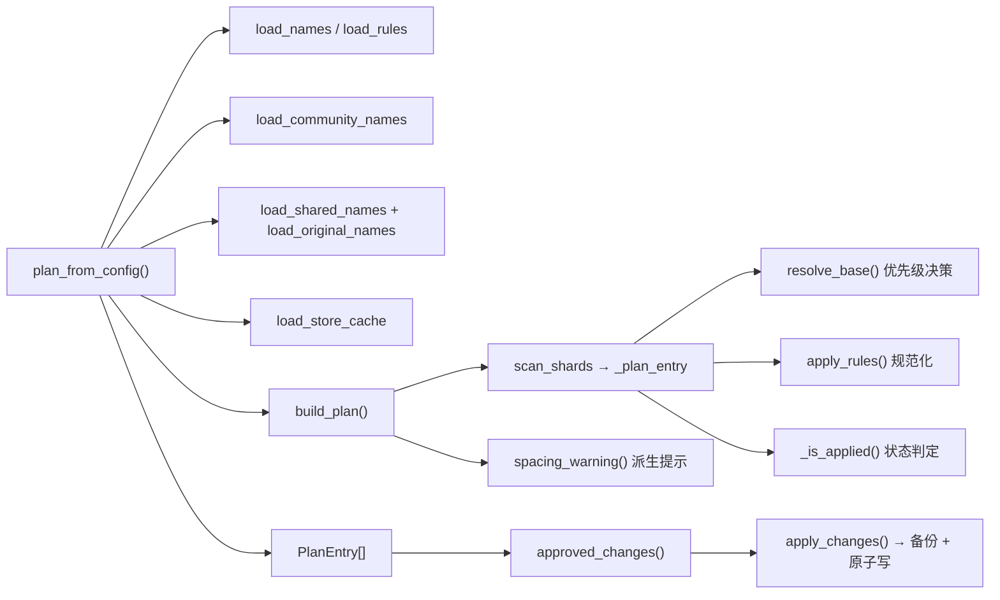
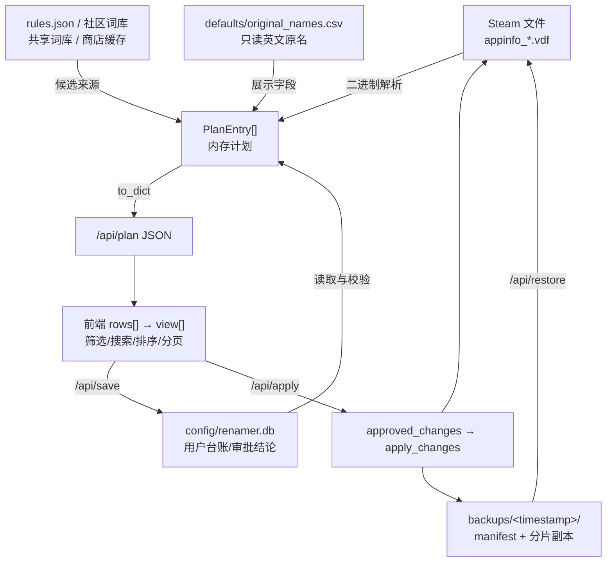
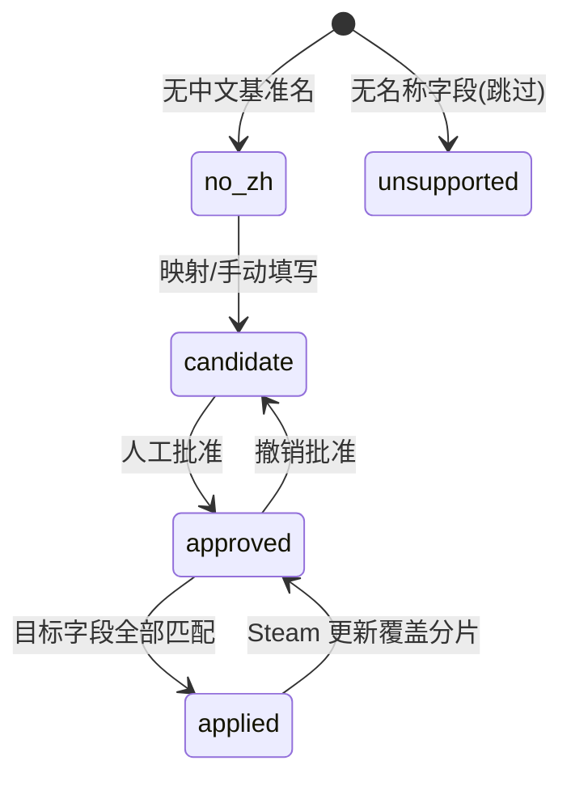
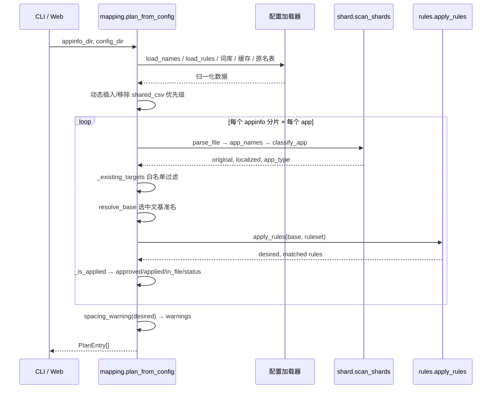

# SteamGameRename 开发者说明

> 版本 0.6.0 · 面向维护与二次开发 · 最后校对基于当前源码

---

## 1. 项目概述

SteamGameRename（2026-11 起统一名称；此前叫「Steam 中文名编辑器」/「Steam Game Rename」）是一个**纯本地**的 Steam 游戏名中文化工具。它直接读写 Steam 客户端缓存的二进制分片 `APPCache/APPInfo/appinfo_*.vdf`，把游戏显示名替换为人工审核过的中文名。

设计边界：

- **数据不出本机**。HTTP 服务只绑定 `127.0.0.1`；联网仅用于主动拉取社区词库（GitHub）与 Steam 商店译名，且失败不影响本地流程。
- **写入必须人工批准**。没有全自动改写通道；规则引擎只产出候选，`mode=auto` 会被加载器直接拒绝。
- **可逆**。每次写入前创建时间戳备份，写入过程中任何异常都会全量回滚。
- **双入口共用一套内核**。Typer CLI 与本地 Web UI 都调用同一个 `plan_from_config()` / `apply_changes()`，避免行为分叉。

项目采用扁平布局：`src/` 下直接是顶层模块，无包嵌套；`run_desktop.py` 在启动时把 `src/` 注入 `sys.path`。

---

## 2. 核心功能

| 功能 | 说明 |
|---|---|
| 分片扫描与解析 | 解析 appinfo v42 分片，提取 `common.name`、`name_localized.{schinese,sc_schinese}`、`common.type` |
| 多来源译名映射 | 按可配置优先级从七类来源选取中文基准名（见 §5.4） |
| 规则规范化 | 6 条有序规则处理英文尾巴、标点、空白、商标符号、中西文间距、书名号 |
| 审批工作流 | 候选 → 人工批准 → 写入；状态区分「已批准 / 已生效 / 文件中已存在」 |
| 安全写入 | 预检目标字段 → 备份 → 重建分片 → 内存二次校验 → 原子替换 → 失败回滚 |
| 备份与恢复 | SHA256 清单校验、时间戳恢复点、按时间倒序列出、保留策略清理 |
| 共享词库 | 随程序分发的 CSV 基线 + 本地覆盖 CSV，支持多人维护、Git diff |
| 本地 Web 编辑器 | 筛选 / 搜索 / 排序 / 分页 / 行内编辑 / CSV 导出 / 状态轮询 / 应用与恢复 |
| 静默同步 | `sync` 命令 / Web「静默同步」按钮：只补回 Steam 更新后丢失的已批准名称，不重复写入已生效项 |
| 自动沉淀英文名 | 启动时扫描分片，把本机独有非中文名写入 `learned_originals.csv`，作为只读展示的本地补充层 |
| 拼音排序键 | opt-in 写入 `common.sortas`（GB2312 首字母），让汉化游戏在 Steam 库按 A–Z 排列 |
| 优雅关闭/重启 Steam | `steam.exe -shutdown` 轮询等待退出 → 写入 → 重启；失败即中止，绝不强制 kill |
| Web 联网更新 | 工具栏触发社区词库更新 / 商店中文名补全，后台线程执行、前端轮询进度 |
| 排版提示 | 检测汉字与数字紧邻并提示加半角空格，**只警告不修改**（`src/vdf.py: spacing_warning`） |

---

## 3. 整体架构

系统分为五层，依赖方向自上而下，反向依赖仅通过 `re-export` 兼容层：


两种运行形态：

- **桌面（唯一用户入口）**：`run_desktop.py` 定位 Steam 目录、自动选空闲端口、创建原生窗口与托盘；HTTP 层复用 `gui.make_handler()`，因此与网页版内核完全一致。
- **CLI**：`python src/cli.py <command>` 执行扫描、规划、写入、同步等批处理命令。

---

## 4. 技术栈、选型与职责

| 技术 | 版本约束 | 在本项目中的职责 | 选型理由 |
|---|---|---|---|
| Python | ≥ 3.11 | 全部后端逻辑 | 需要 `\|` 联合类型、`match` 等现代语法；Windows 上开箱即用 |
| Typer + Rich | ≥ 0.12 / ≥ 13 | CLI 参数解析、表格与彩色输出 | 声明式命令、类型提示即帮助文本；Rich 表格便于预览计划 |
| Pydantic v2 | ≥ 2 | SQLite 台账反序列化结果与 `rules.json` 的 schema 校验、归一化 | 关键价值是**归一化**：避免 `"approved": "false"` 这类宽松真值在下游被误判为真 |
| httpx | ≥ 0.27 | 社区词库下载、Steam Store API 批量查询 | 支持超时、重定向、连接池与重试；比 `urllib` 更易控制 |
| `http.server` (标准库) | — | Web 服务 `ThreadingHTTPServer` | 零额外依赖、易审计；配合 loopback 绑定与 Host/Origin 校验已足够本地场景 |
| 原生 HTML/CSS/JS | — | 单文件前端 `index.html` | 无 Node 构建链、无框架依赖；随程序分发即可运行 |
| setuptools | ≥ 68 | 打包：`py-modules` + `data-files` | 扁平模块布局，静态资源安装到 `share/steam-cn-renamer/` |
| pytest | ≥ 8 | 单元 / API / 快照 / 往返测试 | fixture 固定、快照可 `UPDATE_SNAPSHOTS=1` 重生成 |

依赖被刻意压到 4 个第三方包（桌面壳的 pywebview / pystray / Pillow 在 `desktop` 可选组）。`run_desktop.py` 在依赖缺失时会打印明确的安装命令并返回非零退出码。

---

## 5. 关键技术原理

### 5.1 appinfo v42 分片格式

`src/shard.py` 模块头描述了布局（小端序）：

```
44 字节 header : magic(0x0756442A) universe shard shard_count app_count
                  index_size string_count string_size data_size index_crc header_crc
index region   : 每个 app 16 字节摘要(appid, offset, size, summary_size) + summary_size 字节
string table   : NUL 结尾的 UTF-8 键
data region    : 每个 app [20 字节 SHA1][二进制 VDF blob]，按 offset 连续排列
```

`parse_bytes()` 严格校验：magic、universe（必须为 1）、声明尺寸与实际长度相等、字符串表无残余、索引表无残余、每个 blob 的数据范围合法。`verify()` 进一步核对两层 CRC（索引+字符串表、header 前 40 字节）、数据区无空洞、每个 blob 的 SHA1、数据区总长。

> 注：模块 docstring 写的是「80-byte index entry per app」，实际解析按 `16 + summary_size` 变长处理，以代码为准。

### 5.2 二进制 VDF 编解码

`src/vdf.py` 实现 appinfo 使用的二进制 VDF：

- 键不是字符串本身，而是**指向文件级字符串表的 u32 索引**；值内联在节点后。
- `Node` 保留 `raw` 原始字节与 `trailer`，因此 parse → serialize 往返**字节精确**，这是安全重写的前提。
- 支持 STRING / WIDESTRING / INT32 / FLOAT32 / POINTER / COLOR / UINT64 / INT64 及对象节点。
- `_parse_node()` 有 64 层递归上限，防畸形数据导致的栈溢出。
- `resolve(codec, root, ["common", "name"])` 支持点分路径，`target_path()` 把 `name_localized.schinese` 映射为 `["common", "name_localized", "schinese"]`。
- `set_node_text()` 先经 `validate_name()` 拒绝 NUL、控制字符与超过 1024 字节的值，再以 `utf-8 + \x00` 写入。

### 5.3 完整性校验与原子写入

写入安全性由 `backup.apply_changes()` 统一保证：

1. Steam 进程检测（`tasklist /FI IMAGENAME eq steam.exe`，结果缓存 3 秒），默认要求完全关闭。
2. 分片名合法性校验（`Path(name).name == name`），防路径穿越。
3. `check_targets()` 预检每个目标路径真实存在——不存在的目标是配置错误，快速失败而非静默跳过。
4. `create_backup()` 复制所有分片到时间戳目录，写入 `manifest.json`（`manifest_version=1` + 每文件 SHA256）。
5. `shard.build_bytes()` 重建分片：重新序列化被改的 blob、重算 data offset/size、逐 blob 重算 SHA1、重算 index CRC（header 偏移 36）与 header CRC（偏移 40）、更新 data_size（偏移 32）。
6. 重建结果在内存中再次 `parse_bytes()` + `verify()` + `verify_changes()`，确认无误才落盘。
7. `atomic_write()`：同目录临时文件 → `fsync` → `os.replace`。
8. 任何异常触发 `restore_backup()` 全量回滚；回滚再失败时把两个异常一起报出。

### 5.4 译名优先级与初始英文名保护

`resolve_base()` 按 `defaults.mapping_priority` 顺序选取中文基准名。默认顺序：

```
user_override > shared_csv > local_schinese > local_sc_schinese
              > common_name > community > store_api
```

`common_name` 专门覆盖「appinfo 里 `common.name` 本身就是中文」的条目（如《秦殇》），避免误报「无中文名」。优先级中若出现未知来源直接抛 `ValueError`。

**初始英文名的保存**是一个独立设计：`original_name` 实时读 Steam 文件，一旦写入中文就不再是最初的英文名；台账里的 `original_name` 在历史版本中也已被覆盖。因此项目维护了一份只读对照表 `src/defaults/original_names.csv`（773 条），由 `game_names.load_original_names()` 加载，`PlanEntry.steam_original_name` 取「对照表值 or 台账残留值」。该字段**仅供展示与搜索**，不参与审批或写入判定。

### 5.5 缓存签名与失效

`gui._source_signature()` 收集所有分片与配置文件的 `(文件名, mtime_ns, size)` 作为签名，`plan_payload()` 按签名缓存序列化后的 JSON。未变化时直接返回缓存字节，变化时重算。典型场景下一次 `/api/plan` 从数百毫秒降到十余毫秒。签名纳入两份随包 CSV、`renamer.db`、`renamer.db-wal`、`renamer.db-shm`，因此台账保存、词库更新与数据库写入都会自动使缓存失效；`/api/save` 和 `/api/defaults` 成功后还会主动清空计划缓存。

---

## 6. 主要模块职责与调用关系

| 模块 | 职责 | 关键对外接口 |
|---|---|---|
| `steam_locator.py` | Steam 目录探测（参数 → 环境变量 → 配置文件 → 注册表 → 常见路径 → 盘符扫描） | `detect_steam_dir()`, `is_steam_dir()` |
| `paths.py` | 路径解析、首次配置引导、资源定位（模块同级优先，`sys.prefix/share` 回退） | `asset_dir()`, `default_config_dir()`, `ensure_config()` |
| `vdf.py` | 二进制 VDF codec、名称校验、间距警告 | `BinaryVDF`, `resolve()`, `set_node_text()`, `spacing_warning()` |
| `shard.py` | 分片解析/重建/校验、名称字段提取、目标路径映射、新键追加 | `parse_file()`, `verify()`, `build_bytes()`, `build_bytes_with_new_keys()`, `check_targets()` |
| `backup.py` | 备份创建与校验、原子写、恢复、Steam 进程检测与优雅关闭/重启、写入编排 | `apply_changes()`, `create_backup()`, `steam_shutdown()`, `steam_start()` |
| `pinyin.py` | 零依赖汉字拼音首字母（GB2312 一级字库区位边界表） | `to_initials()`, `sortas_for()` |
| `db.py` | SQLite 唯一事实源：schema、首次迁移、事务写入、备份与按需查询 | `ensure_db()`, `read_ledger()`, `write_ledger()`, `write_community()`, `query_community()` |
| `run_desktop.py` | 桌面壳：pywebview 窗口 + 托盘 + 退出后补写守护 | `main()`, `SteamGuard` |
| `rules.py` | 规则 schema 校验、有序执行、ReDoS 防护 | `load_rules()`, `apply_rules()` |
| `community.py` | 社区词库加载（SQLite + 可选 CSV 覆盖层）与联网更新 | `load_community_names()`, `update_community_names()` |
| `store.py` | 商店中文名批量抓取与磁盘缓存（TTL 30 天） | `fetch_store_names()`, `load_store_cache()` |
| `game_names.py` | 共享词库两层合并、只读原名基线 + 本地学习层、导出、原名一致性校验 | `load_shared_names()`, `load_original_names()`, `merge_original_names()`, `write_learned_originals()`, `check_originals()` |
| `mapping.py` | **核心编排**：配置加载、计划生成、优先级决策、审批分组、静默同步、原名沉淀、拼音排序键 | `plan_from_config()`, `build_plan()`, `approved_changes()`, `pending_changes()`, `learn_original_names()` |
| `cli.py` | 18 个 Typer 命令、退出码归一、计划任务安装 | `main()`, `task_command()`, `export_ledger()` |
| `gui.py` | loopback HTTP 服务、14 个 API、联网后台任务、请求校验、计划缓存 | `make_handler()`, `run_gui()`, `plan_payload()` |
| `version.py` | 单一版本源，供 `/api/status` 与页面徽标读取 | `__version__` |

模块间的兼容层：`mapping.py` 从 `community.py` / `store.py` 重新导出 `load_community_names`、`update_community_names`、`fetch_store_names` 等，供 CLI / GUI / 测试沿用旧导入路径。



---

## 7. 数据与状态流转

### 7.1 数据分层



### 7.2 PlanEntry 状态语义

`PlanEntry` 是贯穿全链路的核心数据结构。状态字段的语义必须区分：

| 字段 | 含义 |
|---|---|
| `original_name` | Steam 文件**当前**名称（可能已是中文） |
| `steam_original_name` | 最初英文名，只读展示字段 |
| `base_name` | 经优先级选中的中文基准名 |
| `desired_name` | 规则处理后的目标名（或台账中已批准的名字） |
| `approved` | 台账中是否批准 |
| `in_file` | 所有目标字段是否都已等于 `desired_name` |
| `applied` | `approved and in_file`，即「批准且已生效」 |
| `status` | `approved` / `candidate` / `no_zh` / `unchanged` / `unsupported` |
| `warnings` | 派生提示（间距建议、词库原名不符），**不写回台账** |

状态的产生分支见 `_plan_entry()`：无主名称字段 → `unsupported`；手动覆盖 → 按 `desired_name` 决定 `approved/candidate/no_zh`；无中文基准名 → `no_zh`；台账已批准 → `approved`；否则规则结果与目标不同为 `candidate`，相同为 `unchanged`。

前端 7 张统计卡：本类条目、已批准、规则候选、无中文名、无需改动、不支持、当前显示。注意「已批准」按 `approved` 标志统计，与其他按 `status` 分类的卡片口径存在包含关系，不可直接相加。

### 7.3 写入状态机



---

## 8. 核心实现流程

### 8.1 计划生成



### 8.2 写入与回滚

`approved_changes()` 只收集 `approved=True`、`desired_name` 非空、`status != unsupported` 且 `targets` 非空的条目，按分片分组为 `{shard: {appid: {target: value}}}`。`apply_changes()` 随后按 §5.3 的流程执行。CLI 的 `apply` 默认 dry-run，必须显式 `--execute`；Web 的 `/api/apply` 直接写入但会先拒绝 Steam 运行中的请求（HTTP 409）。

### 8.3 新用户首次启动

1. `steam_locator.detect_steam_dir()` 探测 Steam 目录（要求 `APPCache/APPInfo` 存在；仅有 `steamapps` 的库目录会给出专门提示）。
2. `ensure_config()` 从 `src/defaults/` 复制缺失的配置模板到配置目录；`ensure_db()` 建立 SQLite，并仅在首次迁移时读取旧 `names.json` / `community_names.json`。
3. 空 SQLite 台账 + 共享词库基线（206 条）→ 新用户直接获得已审核的中文名；老用户已批准的条目优先，不被覆盖。
4. 旧台账中已有的 `defaults.use_shared_names=false` 会保留并继续生效。

### 8.4 Web 请求处理

`gui.make_handler()` 内建 `Handler`，所有请求先经 `_guard()`：重置 `_responded` 标志，捕获异常，若尚未响应才发 500，避免半途异常导致双响应或泄漏 traceback。GET/POST 都先做 Host/Origin 校验（仅允许 `127.0.0.1:{port}` 与 `localhost:{port}`）。

| 方法 | 路径 | 作用 |
|---|---|---|
| GET | `/` | 返回单文件前端 |
| GET | `/api/status` | app 标识、版本、Steam 运行状态、端口、目录 |
| GET | `/api/backups` | 备份列表（含文件数、体积、创建时间） |
| GET | `/api/defaults` | 读取 SQLite 台账的 `defaults`（写入策略） |
| GET | `/api/plan` | 带签名缓存的计划 JSON |
| GET | `/api/task` | 联网后台任务进度（running/kind/done/total/message/error） |
| POST | `/api/save` | 保存台账编辑；校验 `targets` 白名单与名称合法性 |
| POST | `/api/defaults` | 更新写入策略；字段白名单 + 类型校验，保存后清计划缓存 |
| POST | `/api/apply` | 审批写入（要求 Steam 关闭） |
| POST | `/api/sync` | 静默补写未生效的已批准项 |
| POST | `/api/apply-safe` | 优雅关闭 Steam → 写入 → 重启（opt-in，Steam 运行时用） |
| POST | `/api/update-community` | 后台下载社区词库 |
| POST | `/api/fetch-store` | 后台补全商店中文名（`limit` 1–500） |
| POST | `/api/restore` | 从指定备份恢复（校验备份名无路径） |
| POST | `/api/shutdown` | 异步关闭服务 |

请求体上限 5,000,000 字节，非 JSON 对象或非数字 `Content-Length` 均返回 400。前端以 30 秒轮询 `/api/status` 更新 Steam 运行状态。

---

## 9. 配置说明

### 9.1 路径与环境变量

| 项 | 解析顺序 |
|---|---|
| 资源目录 `asset_dir()` | 模块同级目录 → `sys.prefix/share/steam-cn-renamer/<name>` |
| 配置目录 | `STEAM_CN_CONFIG` → 项目 `config/`（存在时）→ `%APPDATA%/steam-cn-renamer` |
| 备份目录 | `STEAM_CN_BACKUPS` → 项目 `backups/`（存在时）→ `%LOCALAPPDATA%/steam-cn-renamer/backups` |
| Steam 目录 | CLI/Web 参数 → `STEAM_DIR` → `launcher.json` → 注册表 → 常见安装路径 → 盘符扫描 |

`launcher.json` 由启动器写入 `steam_dir`、`port`、`detected_by`，位于项目根目录；默认端口 8765，占用时从 8765 起最多尝试 20 个端口，已运行实例会被复用（`--force-new` 可强制新起）。

### 9.2 renamer.db（台账）与 names.json 导出格式

`renamer.db` 是台账唯一运行时事实源。`ledger` 表按 AppID 存储条目，`meta` 表保存 `schema_version`、`meta`、`defaults`、`summary`；`read_ledger()` 会重建为 `load_names()` 使用的 Pydantic 输入结构。

`export-ledger` / `export_names_json()` 导出的 JSON 仍为 `schema_version: 1`，顶层含 `meta`、`defaults`、`summary`、`entries`，便于阅读、diff 与归档；它不是运行时数据源。

`defaults` 关键字段：

```json
{
  "review_required": true,
  "primary_target": "common.name",
  "sync_existing_localized": ["schinese", "sc_schinese"],
  "create_missing_localized": false,
  "use_shared_names": true,
  "mapping_priority": ["user_override", "shared_csv", "local_schinese",
                       "local_sc_schinese", "common_name", "community", "store_api"]
}
```

`entries` 以 AppID 字符串为键，字段包括 `appid`、`shard`、`original_name`、`base_name`、`desired_name`、`applied_rules`、`source`、`targets`、`status`、`approved`、`manual_override`、`note`、`app_type` 等。加载时会校验 key 为数字、`entries[key].appid` 与 key 一致、`targets` 全部通过白名单。**写入目标白名单**：仅 `common.name` 或 `name_localized.<语言>`（语言后缀 `[a-z_]{2,20}`），防止误写 `common.icon` 等元数据字段。

`summary.entries_in_file` 由 `/api/save` 自动维护。

### 9.3 rules.json（规则）

`schema_version: 1`，`execution.order` 决定执行顺序，默认 6 条规则：R1 去英文尾巴、R2 半角标点转全角、R3 清理空白、R4 去商标符号、R5 中西文间距、R6 去书名号。每条规则含 `enabled`、`mode`、`preconditions`、`operations`。

加载约束：正则长度 ≤ 500 字符（防 ReDoS）、flags 仅允许 `i/m/s/x`、`order` 引用的规则必须存在、未列入 `order` 的规则发出警告、**任何 `mode=auto` 都会抛错**。规则只作用于已确定为中文的候选名，纯英文名必须先经译名映射。

### 9.4 词库与对照表

| 文件 | 位置 | 作用 |
|---|---|---|
| `game_names.csv` | `src/defaults/`（基线）+ `config/`（本地覆盖，可选） | 共享词库；列 `GameID,OriginalName,ModifiedName,Source,UpdatedAt,Enabled,Note`；UTF-8 BOM；`Enabled=false` 停用；重复 GameID 后者覆盖前者 |
| `original_names.csv` | `src/defaults/`（只读） | 最初英文原名对照表，773 条，仅供展示与搜索，程序永不改写 |
| `learned_originals.csv` | `config/`（程序维护） | 启动时自动沉淀的本机独有英文名（`GameID,OriginalName`），作为只读展示的本地补充层 |
| `community_names.json` | `config/`（旧版迁移输入） | 首次迁移时备份并导入 SQLite `community` 表；迁移后不再读取 |
| `community_names.csv` | `config/`（可选覆盖层） | 显式本地覆盖 SQLite 中的社区词条 |
| `store_cache.json` | `config/` | `{appid: {name, fetched_at}}`，TTL 30 天，由 `fetch` 命令写入 |

CSV 读取兼容 UTF-8 BOM / UTF-16 / GBK；解析失败不会静默返回空表，最后兜底用 `replace` 解码并保留警告。

### 9.5 CLI 命令

`python src/cli.py [全局选项] <命令>`，全局选项 `--steam-dir`、`--config-dir`、`--backup-root`。可用命令：

`scan`、`plan`（`--all` / `--json` / `--type`）、`verify`、`apply`（默认 dry-run，`--execute` 落盘）、`sync`（静默补写未生效的已批准项；`--auto-restart` 关闭重启、`--skip-if-running` 静默跳过）、`learn-originals`（沉淀本地英文名）、`restore`（`--backup`）、`backups`、`prune-backups`（`--keep`，默认 8）、`fetch`（`--limit`）、`update-community`、`export-ledger`（`-o`，从 SQLite 导出 JSON 台账）、`export-mappings`（`-o`，导出共享 CSV）、`validate-mappings`、`install-task`（`--daily HH:MM`）、`uninstall-task`。

退出码由 `main()` 归一：`CliExit`/`typer.Exit` 保留原码，`BadParameter`、`BackupError`、`ValueError`、`FileNotFoundError`、`OSError` 统一为 1。

---

## 10. 已知限制

- **格式与平台**：只支持 appinfo v42（magic `0x0756442A`，universe 1）；Steam 进程检测、注册表探测面向 Windows，非 Windows 下 `steam_running()` 恒为 `False`。
- **审批刚性**：所有改名必须人工批准，未开放自动写入；`mode=auto` 配置会被拒绝加载。
- **不可写条目**：部分 DLC 在 Steam 数据里没有名称字段，标记为 `unsupported` 并跳过，不参与写入。
- **Steam 必须关闭**：写入与恢复默认要求 Steam 完全退出（含托盘）；`--allow-running` 可绕过，但不推荐，Steam 可能在退出时回写缓存。Web 端提供 opt-in 的「自动安全关闭并重启」：走 `steam.exe -shutdown` 轮询等待，20 秒未退出即中止写入，绝不强制 kill（避免云存档损坏）。
- **英文名覆盖不完整**：只读基线 `original_names.csv` 覆盖 773/803 条；另有本地学习层 `learned_originals.csv` 在启动时自动沉淀本机独有的非中文名。原本就以中文命名的游戏没有英文原名记录，前端回退显示当前名。基线需随版本手动维护。
- **联网功能可失败**：商店 API 批量请求失败会重试 3 次后静默跳过，社区词库下载失败抛 `ValueError`；两者都不影响本地计划生成。
- **服务安全边界**：Web 服务无认证，仅靠 loopback 绑定与 Host/Origin 校验；不要暴露到局域网或公网。
- **并发**：写操作由进程内 `threading.Lock` 串行化；联网后台任务用独立的 `task_lock`。启动器会复用已有实例，但没有跨进程文件锁（CLI 与 Web 同时写入仍可能冲突）。
- **缓存失效粒度**：`_plan_cache` 与分片缓存均按文件 `mtime_ns` + `size` 签名，若外部修改文件却保持两者不变，缓存不会刷新（`prune-backups` 不影响此逻辑）。
- **SQLite 必须保留**：迁移后旧 JSON 不再是恢复源；若 `renamer.db` 被删除且存在 `migration-backups/`，程序会拒绝自动重建，以防重新导入过期 JSON。请从迁移备份或另行复制的数据库恢复。
- **db 并发**：SQLite 使用 WAL + `timeout=10`，可承受同进程多线程；跨进程（CLI 与 Web 同时写）仍可能遇到 `database is locked`，与既有的跨进程锁缺失是同一限制。
- **Steam 仍会覆盖部分汉化**：实测 26 次启动中 65% 会写分片（多在服务器端有 app 更新时），被覆盖的通常是 1–20 个分片，`sync` 可精确补回。详见 §13.3。程序不会自动运行，需用户手动同步、装计划任务或（未来的）托盘守护。
- **备份清理**：`prune_backups()` 只处理备份根目录下直接包含 `manifest.json` 的子目录，`keep=0` 会报错。
- **规则与输入上限**：单条正则 ≤ 500 字符；写入名称 ≤ 1024 字节且不含控制字符；Web 请求体 ≤ 5 MB。
- **前端窄屏**：表格在 760px 以下改为横向滚动（最小宽度 760px），而非重排为卡片，编辑列始终可用。

---

## 11. v0.4.3 新增能力

本章记录相对 0.4.2 的四项增量，均保持"人工批准才写入、数据不出本机、失败可回滚"的既有边界。

### 11.1 静默同步（sync）

Steam 更新游戏或重启客户端拉取元数据后，会重写 appinfo 分片，使已批准的名称从"已生效"退回"已批准"。此时无需重新打开审批流程，只需补写：

- **判定**：`pending_changes(plan)` 只挑 `approved && !in_file && status != unsupported` 的条目，已生效项不重复写入。
- **CLI**：`python src/cli.py sync` 默认 dry-run，`--execute` 才真正备份写入；`--allow-running` 可绕过 Steam 检测（不推荐）。
- **Web**：顶栏「静默同步」按钮调用 `/api/sync`，同样复用 `apply_changes()` 的备份 + 校验 + 回滚链路。
- **安全**：只针对已批准项，不重新审批、不改台账；Steam 运行时返回 409 拒绝。

### 11.2 自动沉淀英文名（learned_originals.csv）

只读基线 `defaults/original_names.csv`（随版本分发、程序永不改写）之外，新增本机补充层：

- **来源**：`learn_original_names()` 扫描分片，把当前 `common.name` 为非中文、且基线未覆盖的 AppID 写入配置目录的 `learned_originals.csv`（UTF-8 BOM）。
- **触发**：CLI `learn-originals` 命令；Web 服务启动时后台线程自动执行一次（失败静默，绝不影响主流程）。
- **合并**：`merge_original_names()` 用基线覆盖学习层（基线优先），仅供 `steam_original_name` 展示与搜索，**不参与**目标解析与写入。
- **意义**：新游戏、地区限定名在日常使用中自动沉淀，降低基线手动维护成本。

### 11.3 拼音排序键（common.sortas）

Steam 库按 `common.sortas` 字符串排序。汉化后若该字段为空，游戏会按中文 Unicode 码乱序排列。

- **开关**：`defaults.write_sortas_pinyin`（默认 `false`，opt-in）。开启后，`build_plan()` 给已批准条目计算 `sortas`。
- **转换**：`pinyin.py` 用 GB2312 一级字库的拼音有序特性做区位边界二分查找，零第三方依赖；常用汉字转大写首字母（猛兽派对 → `MSPD`）。二级字库（按部首排）无法用此法推断，保留原字而非猜测，避免误导排序。
- **写入路径**：真实数据 803 条里仅 7 条有 `sortas` 字段，故多数条目需要新增键。`build_bytes_with_new_keys()` 把新 key 追加到分片 string table 末尾——既有 key 索引全部不变——再在 `common` 下插入 string 子节点，最后重算数据区 SHA1、索引偏移、双层 CRC。`check_targets(..., allow_create={"common.sortas"})` 放行缺失目标，`apply_changes()` 按 changes 自动选择新旧构建路径。
- **字节精确保障**：新增键后 `verify()`（index CRC + header CRC + 每 app SHA1）与 `verify_changes()` 均通过；未改动的 app blob 逐字节不变；原子写 + 失败回滚链路不变。

### 11.4 优雅关闭与重启 Steam

Web 应用写入弹窗在检测到 Steam 运行时，额外提供"自动安全关闭 Steam，写入完成后重启"选项：

- **端点**：`/api/apply-safe` 接收 opt-in 信号，流程为 `steam_shutdown(exe)` → `apply_changes()` → `steam_start(exe)`，全程持有写锁。
- **优雅退出**：`steam_shutdown()` 调用 `steam.exe -shutdown`，每 0.5 秒轮询 `steam_running()`，20 秒超时即返回 False 并中止写入。绝不 `taskkill`，避免云存档损坏。
- **失败处理**：关闭失败返回 409 并提示手动退出；写入失败走既有回滚；重启失败返回 `restarted: false`，提示用户手动启动。
- **边界**：CLI `apply --allow-running` 仍是绕过通道（不推荐）；该选项不写入台账、不影响审批状态。

### 11.5 Web 联网更新入口

- **端点**：`POST /api/update-community`（下载社区词库）、`POST /api/fetch-store`（按 limit 补全商店中文名）、`GET /api/task`（进度）。
- **执行**：后台线程 + 独立 `task_lock`，同一时刻只允许一个联网任务；完成/失败后清空 `/api/plan` 缓存使签名失效。
- **前端**：工具栏「词库更新」弹窗，轮询进度条；任务进行中禁用按钮，结束后自动刷新计划。
- **安全**：沿用 Host/Origin 校验；联网失败写入 `task_state.error`，不影响本地计划生成。

---

## 12. v0.4.4 修复与增强

### 12.1 三个边缘漏洞修复

1. **原名学习污染**：`learn_original_names()` 现在读取 SQLite 台账，跳过 `approved=True`、`manual_override=True` 或 `desired_name` 非空的 AppID。此前用户把《Counter-Strike 2》改成别名 `CS2` 后，后台学习会把这个纯英文别名当成"最初英文名"写入 `learned_originals.csv`。台账缺失或损坏时静默降级为"只学纯净条目"，不阻断主流程。
2. **CLI `apply` 预检漏放行**：第 183 行的 `check_targets()` 此前未传 `allow_create`，开启 `write_sortas_pinyin` 后 `apply --execute` 会在预检阶段报"目标字段不存在: common.sortas"。现改为与 `sync`、`backup.py` 共用 `backup.CREATABLE_TARGETS` 常量，杜绝三处定义漂移。
3. **`sync` 无法在 Steam 运行时工作**：CLI 增加 `--auto-restart`（`steam_shutdown` → 写入 → `steam_start`，关闭失败即中止，写入异常也保证拉起 Steam）；`/api/sync` 接受 `{"auto_restart": true}` 并兼容旧前端的无请求体 POST。前端在 Steam 运行时先弹出云存档风险确认。新增 `--skip-if-running`：Steam 运行时安静跳过并以 0 退出，供计划任务使用。

### 12.2 静默守护任务

- `install-task` / `uninstall-task`：通过 `schtasks /Create|Delete` 管理任务 `SteamCNRenamer_Sync`，默认 `ONLOGON` 触发，`--daily HH:MM` 可改为每日定时。
- 任务命令由纯函数 `task_command()` 生成：使用 `pythonw.exe`（无控制台）+ `sync --execute --skip-if-running`。路径含引号或 `%` 时直接拒绝，防止 `/TR` 参数注入。
- 设计边界：只在 Steam 未运行时补写；运行中不打扰玩家，等下次登录再补。任务不会自行重新安装依赖，也不会绕过审批——只写台账中已批准的条目。

### 12.3 Web 写入策略配置栏

- `GET /api/defaults` 返回 SQLite 台账的 `defaults`；`POST /api/defaults` 只接受字段白名单（`review_required`、`primary_target`、`sync_existing_localized`、`create_missing_localized`、`write_sortas_pinyin`、`mapping_priority`），带类型/语言代码/目标合法性校验，保存后清空 `/api/plan` 缓存。
- 前端「写入策略」弹窗可视化勾选 `tchinese` 简繁同步、`write_sortas_pinyin` 拼音排序、`create_missing_localized`，无需手工编辑 JSON。所有改动仍走 `load_names()` 的 Pydantic 校验，且不影响已有审批状态。

### 12.4 原名表自动更新流水线

- `scripts/update_original_names.py`：曾从 Steam `ISteamApps/GetAppList/v2/` 拉取全量 AppID/名称，只追加缺失且为纯 ASCII 名称的条目，默认上限 200 条，支持 `--dry-run`。
- **绝不覆盖已有行**：本表记录"最初英文名"，而 AppList 返回的是当前名（可能已改名）；覆盖会破坏语义。
- `.github/workflows/update-db.yml`：原定每周一 03:00 UTC 运行并自动开 PR。

> **2025-11 失效**：Valve 已下线 `ISteamApps/GetAppList`。实测 `GetSupportedAPIList` 显示该接口只剩
> `GetSDRConfig` / `GetServersAtAddress` / `UpToDateCheck`，`GetAppList` 已移除；v2 / v0002 / v1 全部 404。
> 官方替代 `partner.steam-api.com/IStoreService/GetAppList/v1/` 需要 Steamworks 发行商 key，普通开发者拿不到。
>
> 处置：`schedule` 已注释掉（避免每周空跑失败），保留 `workflow_dispatch` 供手动排查；脚本遇 404 时会打印
> 明确结论而非 traceback。**`original_names.csv` 现改为手工维护**：追加 `GameID,OriginalName,ModifiedName` 三列即可，
> 程序只把它当只读基线，不改写。

---

## 13. v0.4.5 性能优化与 Steam 重写实测

### 13.1 分片增量缓存

`mapping.scan_shards()` 现在按 `(mtime_ns, size)` 缓存已解析的 `Shard`，用 `_shard_cache_lock` 保护。命中条件要求两项指纹完全一致，任一变化即重新解析——写入后文件 mtime 必变，因此不存在"读到过期树"的窗口。

实测（247 个分片 / 2.6 MB / 803 条）：

| 场景 | 耗时 |
|---|---|
| 冷启动（全量解析） | 349 ms |
| 稳态（缓存全命中） | **19 ms** |
| Steam 只改 1 个分片 | **20 ms**（只重解析那 1 个） |

`Shard` 一旦缓存即视为不可变：`build_bytes()` 会重新解析每个 blob 再改，不会原地修改缓存树。`clear_shard_cache()` 供测试与手工干预使用。

`vdf.Node` 同时改为 `@dataclass(slots=True)`，省约 3% 解析时间与一部分对象内存；收益小但无风险。

### 13.2 三个被实测否决的方案

记录在此，避免后续重复尝试：

1. **线程池并行解析**：8 线程 240 ms vs 串行 221 ms，**慢 8%**。解析是 CPU 密集型纯 Python 字节操作，GIL 下线程只增加切换开销。
2. **按 shard 名按需解析**：只解析"台账中已批准条目所属的 159 个分片"，实测仅省 17%（148→123 ms）。原因是这 159 个分片占 88% 字节量，未选中的 88 个都是 4 KB 级小文件。更重要的是存在**正确性风险**：Steam 重组分片后台账里的 `shard` 字段会过期，按名字过滤会永久漏掉迁移到其他分片的游戏。已放弃。
3. **pickle 缓存解析结果**：反序列化 258 ms（只比重新解析快 27%），还要 193 ms 序列化与 9.9 MB 磁盘占用。不划算。

结论：解析成本是硬性的（2.6 MB → 145 ms），唯一可行方向是**减少重复解析次数**，即 13.1 的增量缓存。

### 13.3 Steam 何时重写 appinfo —— 基于 `logs/appinfo_log.txt` 的实测

统计该机 26 次 Steam 启动（2026-11-22 ~ 11-24）：

| 行为 | 次数 | 占比 |
|---|---|---|
| 完全不写分片 | 9 | 35% |
| 写 1–20 个分片（服务器端有 app 更新） | 12 | 46% |
| 全量重写 247 个分片 | 5 | 19% |

关键结论：

- **纯启动不一定覆盖**：9 次启动只有 `ThreadedReadShards` 读取、无任何写入，汉化不会被重置。
- **覆盖是按 appid 粒度的**：日志 `apps updated 1` 对应 `App cache succeeded writing 2 shards (11 apps)`。真正被覆盖的通常只有 1–20 个分片，`pending_changes()` 能精确补回。
- **全量重写由缓存重建引起**，不是改名的必然后果：日志显示这些会话伴随 `full data, 1024 prev attempts` 与 `Requested 7 app access tokens, 0 received, 7 denied`——是 token 被拒导致的反复重试与缓存重建（多见于家庭共享/区域受限条目），与写入 name 字段无关。
- **改名不会破坏 change number 校验**：change number 存在 `packageinfo.vdf`，appinfo 分片本身不携带，因此改 `common.name` 不会被 Steam 判定为"本地数据过期"。

对"托盘守护"方案的含义：**"Steam 退出后补写"有效但不完美**——它能维持到下次 Steam 因更新重写那几个分片为止。要做到"永不回退"，需要在 Steam 启动前补写（启动器包装），而不是退出后补写。两者可叠加。

---

## 14. SQLite 唯一事实源（v0.6.0）

### 14.1 存储分工

`renamer.db` 是台账与词库的唯一运行时事实源。JSON 不再作为主存或镜像；旧文件只在首次迁移时读取，显式导出用于备份与人工查看。

| 数据 | 表 / 文件 | 访问方式 |
|---|---|---|
| `ledger`（台账） | `ledger` + `meta` | 每次保存全量事务替换；读取时重建完整台账并做 Pydantic 校验 |
| `community` | `community` | 本地 AppID 按需查询；更新时事务清表重写 |
| `store_cache` | `store_cache` | 本地 AppID 按需查询；抓取后事务替换 |
| `original_names` | `original_names` | `(appid, source)` 联合主键，baseline 优先于 learned |
| `shared_names` | `shared_names` | CSV 指纹变化时重新导入；全量读取 206 条基线 |
| `rules.json` | JSON | 小、需人工编辑，保持文件形式 |
| `community_names.csv` | CSV（可选） | 显式覆盖 SQLite 社区词条，不参与词库更新写入 |

所有既有加载函数签名保持不变，调用方无需感知迁移细节。`STEAM_CN_RENAMER_NO_DB=1` 仅用于测试纯文件路径，正常桌面运行不应设置该变量。

### 14.2 首次迁移与冲突处理

`ensure_db()` 无论新建库还是打开旧库，都会检查 `meta.ledger_migrated` 与 `meta.community_migrated` 两个幂等标记：

1. 迁移前把旧 JSON 复制到 `config/migration-backups/`；若旧 SQLite 已有台账，则再用 SQLite backup API 备份数据库。
2. 旧运行时以 JSON 为准，因此 JSON 与旧 DB 冲突时，首次迁移选择 JSON，保持旧程序最后一次可观察结果。
3. 旧 JSON 先经过与保存链路相同的 Pydantic 校验；验证通过后才写入 SQLite 并设置迁移标记，失败不会把坏数据标记为已迁移。
4. 迁移完成后，`names.json` / `community_names.json` 的后续编辑会被忽略，避免双源漂移。
5. `names.json` 损坏且 SQLite 无可用台账时直接报错；SQLite 已有可用数据时保留 DB、备份损坏 JSON 并完成迁移。

`export-ledger -o names-export.json` 从当前 SQLite 台账生成 JSON；目标文件已存在时拒绝覆盖。`export-mappings` 同样先从 SQLite 读取，不再直接读取旧 JSON。

### 14.3 台账与社区词库写入

- `save_names()` 先做完整 schema 与 target 白名单校验，再由 `write_ledger()` 在单个事务中 `DELETE + executemany INSERT + meta 更新`。非法类型或数据库失败都不会留下半份台账，也不再改写 JSON。
- `update_community_names()` 先下载并校验上游数据，再在单个事务中清空 `community` 表并写入新词条。任一 INSERT 失败会完整回滚，旧词库继续可用。
- 数据库连接使用 WAL + `synchronous=FULL` + 10 秒 busy timeout，保证提交耐久性；跨进程并发仍受既有锁边界限制。

### 14.4 按需查询与缓存

SQLite 的主要收益在词库按 AppID 查询，而不是全量加载台账。历史实测中，803 个本地 AppID 查询 40 万条 JSON 词库约需 250 ms，而 SQLite 主键 `IN` 查询约 1 ms。台账全量读写略慢于 JSON，但换来单事务、单事实源和明确迁移边界。

`/api/plan` 缓存签名包含分片、配置 CSV、`renamer.db`、`renamer.db-wal` 与 `renamer.db-shm`；保存台账和更新 defaults 后还会主动清空缓存，避免 SQLite 已提交但页面仍显示旧计划。

### 14.5 已验证的安全边界

- **迁移无损**：用仓库中真实 803 条台账副本演练，`entries/defaults/summary/meta` 逐字段一致，差异 0；原 JSON 字节不变，迁移备份存在。
- **保存只写 SQLite**：生产路径保存后不生成或改写 `names.json`；显式 `export-ledger` 才能得到 JSON。
- **迁移后 JSON 不生效**：损坏或手工修改旧 JSON 都不会覆盖已迁移台账。
- **社区更新原子**：旧词条删除、新词条写入与失败回滚均有 SQLite trigger 故障注入测试。
- **无效保存被拒绝**：`desired_name=123` 等类型错误在写库前返回 400，数据库保持原值。


---

## 15. v0.4.7 桌面壳

### 15.1 结构

`run_desktop.py` 把同一套 loopback 服务包进原生窗口，HTTP 层一行未改：

```
run_desktop.py
├── ThreadingHTTPServer(127.0.0.1, port=0)   # 复用 make_handler，端口自动分配
├── SteamGuard                                # 守护线程：运行→退出 边沿补写
├── pystray.Icon（run_detached）              # 托盘菜单
└── webview.create_window → webview.start()   # 主线程阻塞
```

- **写锁共享**：`make_handler(..., write_lock=...)` 新增可选参数，托盘触发的同步与 Web 的「应用写入」共用同一把 `threading.Lock`，不会并发写同一分片。
- **退出联动（v0.5.2）**：`make_handler(..., on_shutdown=...)` 让网页的「退出服务」能拆掉整个程序。桌面版把 `quit_app` 延迟绑定后传入，`/api/shutdown` 先返回 `{"desktop": true}`、再延迟 0.2 s 关窗口与托盘，避免前端看到连接被重置。关键坑：`window.destroy()` 同样会触发 `closing` 事件，而"关闭即收进托盘"的处理器返回 `False` 会把它取消——所以 `on_closing` 必须检查 `quitting.is_set()` 并放行，否则服务停了但窗口和进程还赖着（已实测复现并修复）。
- **依赖降级**：`missing_desktop_deps()` 检测 `webview/pystray/PIL`，缺失时打印原因并调用 `run.main([])` 回退浏览器模式；`webview.start()` 抛错时同样回退。`启动桌面版.bat` 会先尝试 `pip install`，失败再降级。
- **退出清理**：`finally: shutdown()` 依次停守护、停托盘、关服务，避免残留幽灵进程。

### 15.2 为什么用轮询而不是 watchdog

`watchdog` 只能监听**文件系统**。监听 `APPCache` 目录会在 Steam **正在写**分片时触发——恰是我们必须退避的时刻；而监听"Steam 进程退出"它做不到（需要 psutil 或 WMI）。

因此守护用 `steam_running(ttl=0)` 每 30 秒轮询一次（`tasklist` 约 50 ms，即 0.17% CPU），只在**运行→退出**的边沿动作：

```python
@staticmethod
def should_sync(was_running, running) -> bool:
    return bool(was_running) and not running   # 初始 None 不触发
```

启动时若 Steam 未运行，先补一次（把上次被覆盖的汉化写回），然后进入边沿监听。`interval` 有 5 秒下限，防止把轮询设得过密。

### 15.3 验证状态

| 项目 | 状态 |
|---|---|
| pywebview 窗口创建→销毁→`start()` 返回 | **实测通过**（Python 3.12 + pywebview 6.2.1） |
| 托盘图标生成（PIL 几何绘制，无外部资源） | 单测通过（PNG 头校验） |
| 边沿判断 / 间隔下限 / Steam 运行中跳过 | 单测通过 |
| 依赖缺失回退、`--check` 自检 | **实测通过** |
| 关闭按钮收进托盘（`events.closing` 返回 False） | **实测通过** —— 用户 Windows 环境确认 |
| 托盘右键菜单交互、WebView2 渲染 | **实测通过** —— 用户确认 |

v0.4.8 实测记录：用户确认点窗口 × 能收进托盘、托盘右键菜单功能正常。真实配置目录首次启动自动迁移：803 条台账 + 994 条词库 + 773 条原名，与 `names.json` 逐字段一致；迁移过程**未改写** `names.json`（其 mtime 保持不变），说明迁移是只读建库。

若某版本 `closing` 语义变化导致关闭即退出，`finally` 仍会完整清理；也可用 `--no-tray` 明确选择"关闭即退出"。

### 15.4 依赖与体积

`pywebview` 在 Windows 走 .NET 的 WebView2（需 `pythonnet`），连带 `pystray` 依赖 `Pillow`，实际新增约 4 个包、安装后约 15 MB（不含系统自带的 WebView2 Runtime）。这些放在 `pyproject.toml` 的 `desktop` 可选组，不装也不影响原有浏览器模式。

---

## 16. v0.5.2 命名统一与退出联动

### 16.1 显示名统一为 SteamGameRename

此前项目有「Steam Game Rename」「Steam 中文名编辑器」两种写法，与仓库名 `SteamGameRename` 都不一致。本次把**用户可见名称**统一：

| 位置 | 改动 |
|---|---|
| 网页标题 / 顶栏品牌 | `Steam Game Rename` → `SteamGameRename`，品牌字母 `A` → `S` |
| 桌面窗口标题 | `Steam Game Rename` → `SteamGameRename` |
| 托盘提示与通知 | 同上 |
| `run.py` 启动横幅与 `--help` | 同上（该文件已在 v0.5.3 拆分，见 §17） |
| 文档标题（README / 使用说明 / 开发者说明） | 同上 |
| 桌面快捷方式名（`tools/create-shortcut.ps1`） | `Steam Game Rename.lnk` → `SteamGameRename.lnk` |
| 浏览器入口脚本文件名 | `Steam 中文名编辑器.bat` → `SteamGameRename.bat`（`git mv` 保留历史） |

**刻意保留的旧标识**（改名会导致已有用户出问题，收益为零）：

- `%APPDATA%\steam-cn-renamer` / 项目内 `config/`：配置目录，改名等于让老用户的 803 条台账"消失"
- `pyproject.toml` 的 `name = "steam-cn-renamer"`：已发布的包名
- `/api/status` 的 `app` 字段：前端与诊断脚本凭它确认连到的是本程序（单实例检测已改为端口锁，见 §17）
- 计划任务名 `SteamCNRenamer_Sync`：改名会让已安装的任务变成孤儿

### 16.2 「退出服务」关闭整个程序

浏览器模式原本就是停服务即可（页面自己关掉）。桌面模式此前只停 HTTP，窗口与托盘还留着，变成没有后端的空壳。

现在：`/api/shutdown` → 返回 `desktop: true` → 延迟 0.2 s 调 `on_shutdown` → 停守护、停托盘、`window.destroy()` → `webview.start()` 返回 → `finally` 收尾 → 进程退出。

前端见到 `desktop: true` 就不再显示"服务已停止"卡片（窗口马上就没了）。

实测：启动桌面版 → POST `/api/shutdown` → 服务停止 → 进程 exit code 0。

---

## 17. v0.5.3 只保留桌面版

### 17.1 入口收敛

仓库与分发包只提供**桌面版**一种形态，浏览器模式下线：

| 变更 | 说明 |
|---|---|
| 删除浏览器入口 | 原 `SteamGameRename.bat`（调用 `run.py` 开浏览器）已移除 |
| 桌面版入口改名 | `启动桌面版.bat` → `SteamGameRename.bat`，成为唯一入口 |
| `run.py` 拆分 | 探测逻辑移入 `steam_locator.py`；浏览器启动、端口复用、`APP_MARKER`、`run_gui` 调用一并删除 |
| 依赖缺失处理 | 不再"回退浏览器"，改为打印安装命令并返回非零退出码 |
| 快捷方式 | `创建桌面快捷方式.bat` 生成的 lnk 现在直接指向桌面版入口 |

`src/gui.py` 的 HTTP 层完全保留——桌面壳复用它，`run_gui()` 仅作为开发者调试入口保留。

### 17.2 单实例锁（删除 run.py 的补偿）

`run.py` 原本会探测并复用已有实例。删除后若允许双开，两个进程会各起一个守护线程，而 `write_lock` 只在进程内有效，可能并发写同一分片。

因此桌面版绑定固定端口 `17650` 作为跨进程锁（只 bind 不服务，进程退出由系统释放）：

- 绑定失败 → 提示"已在运行"并返回 0（不弹错误框）
- 端口被其它程序占用导致误判 → 可用 `--force-new` 跳过

---

## 18. v0.5.5 外部审查落实情况

2026-11-25 收到一份外部代码审查（19 项：3 高 / 7 中 / 9 低）。逐项复核并实测后处理如下。

### 18.1 已修复

- **H-3 Web 保存丢自定义字段（真实数据丢失）**：`/api/save` 原先用白名单**整条替换** `entries[appid]`，而 `_validate_ledger` 明确保留用户手加的白名单外字段——两者矛盾，保存一次即静默丢弃。改为合并：先保留非白名单字段，再用新值覆盖白名单字段。回归测试 `test_custom_field_survives_save`。
- **M-2 Handler 无 socket 超时**：新增 `HANDLER_TIMEOUT = 30`。原本客户端声明 `Content-Length` 却不发字节时会永久占住一个线程，`ThreadingHTTPServer` 每连接一线程，本机进程可低成本耗尽。
- **M-5 缺 CSP**：HTML 响应补 `default-src 'none'` / `connect-src 'self'` / `frame-ancestors 'none'`（单文件内联脚本仍需 `unsafe-inline`）。测试 `test_html_response_has_csp`。
- **M-6 无测试 CI**：新增 `.github/workflows/test.yml`，Ubuntu + Windows × Python 3.11/3.12/3.13 矩阵。

### 18.2 实测后不修（附理由）

- **H-1 解析树常驻内存**：报告称 7.2x 放大、"大库可达 GB 级"。本机实测：247 分片共 **2.6 MB** → 常驻 **33 MB（12.8x）**。倍数属实且更高，但绝对量远未到 GB——那需要分片总量上百 MB。修法（惰性 `root` + 摘要 + 释放树）要碰字节级无损的核心路径，风险大于当前收益。待分片总量显著增长再评估。
- **H-2 商店 appdetails 批量请求**：批量拼接确实非官方支持、可能只返回首个应用。但该路径仅服务"补全商店中文名"这一**辅助**功能，失败只影响候选质量，不触及写入安全。改逐个请求会把 1 次调用变 50 次（约 10–15 秒），需重做进度与限流设计，单独排期。
- **M-1 TOCTOU**：解析与写入之间分片被改写的窗口真实存在，但已有 `steam_running` 前置检查、全量备份与校验回滚兜底；修法要给 `Shard` 加 `source_key` 并改 `apply_changes` 签名，动核心结构。
- **M-3 备份半成品目录 / M-4 进程检测 fail-open**：两者都成立，但改动落在"安全底座"本身，需要单独一轮回归矩阵，不与功能修复混在一起。
- **L-1 ~ L-9**：健壮性与代码卫生（父目录 fsync、pythonw 探测、脏行回传、db 写放大、ruff/mypy、路径求值时机、应用前复用缓存、shutdown token、下载体积上限），按顺手原则后续消化。

---

## 19. v0.5.6 第二份外部审查的核实结论

2026-11-25 收到第二份外部审查（基于 GitHub 源码阅读）。该报告列了 5 条「高优先级」，逐条核对后
**3 条不成立或已解决，1 条是设计选择，1 条是真实边界**——记录在此避免重复讨论。

| 报告结论 | 核实结果 | 处置 |
|---|---|---|
| 全局可变缓存会串数据、内存只增不减 | **不成立**。`_shard_cache` 的键是 `str(path)`（完整路径），`_plan_cache` 的键是 `f"{appinfo}\|{config_dir}"`。不同配置目录天然隔离；键数量受分片数封顶，每个键只存最新版本，内存有界（实测 247 分片 → 33 MB） | 不改 |
| 版本硬编码分散，`version.py` 与 `pyproject.toml` 可能不同步 | **已在 v0.5.1 解决**：`test_pyproject_version_matches_source` 断言两处相等，并列入 CI | 不改 |
| 测试单文件 92 KB，难维护 | 属实，但它是按功能分组的 34 个测试类，`-k` 与类选择都正常；拆分只增加文件跳转成本，不改善失败定位 | 不改 |
| 扁平模块布局是工程债务 | **是刻意的设计选择**。本项目的分发形态是「解压 + 双击 bat 运行」，不走 `pip install`；扁平布局让 `run_desktop.py` 注入 `sys.path` 即可，打包与用户侧零安装。改成包结构要同步改 17 个模块的 import、pyproject、bat、测试与文档，还要让所有用户重新部署，收益（命名空间更干净）与代价不匹配 | 不改，代价见右 |
| Steam 进程检测仅 Windows | **属实且确实是风险**：非 `nt` 时 `steam_running()` 恒为 False，等于放弃「运行中不写入」这条保护，而 Linux 用户带 `--steam-dir` 是能启动的 | **已修**，见下 |

### 19.1 平台守卫（唯一实际改动）

`apply_changes()` 开头新增：

```python
if os.name != "nt" and os.environ.get("STEAM_CN_ALLOW_NON_WINDOWS") != "1":
    raise BackupError("本工具仅支持 Windows：非 Windows 平台无法检测 Steam 进程…")
```

- 只挡**写入**，不影响 `/api/status` 等只读接口（否则会把状态页打成 500）
- 测试与 Linux CI 通过 `STEAM_CN_ALLOW_NON_WINDOWS=1` 显式放行，跨平台回归矩阵照常跑
- 新测试 `test_non_windows_write_is_refused` 用 `mock.patch.object(os, "name", "posix")` 验证

### 19.2 未采纳的建议及理由

- **规则 ReDoS**：`_MAX_PATTERN_LENGTH = 500` 确实挡不住灾难性回溯，但规则文件是**用户本地的** `config/rules.json`，威胁模型等价于「自己写错正则」；且匹配对象是游戏名（通常 < 200 字符），最坏情况是界面卡顿几秒而非不可用。加超时需引入线程或第三方库，成本高于风险。
- **GUI 抽 service 层**：`gui.py` 28 KB 确实偏大，但拆分会同时改动鉴权、事务、任务状态三块，回归面大于可读性收益。
- **包结构重构 / 测试拆分 / 类型检查**：见上表，属长期可选项，不在当前阶段。

---

## 20. v0.5.7 第三轮审查（DeepSeek + ChatGPT）落实情况

两份报告都按「结论必须可复现」写，质量明显高于前两轮，**指出的多为真问题，其中两项是我自己引入的**。
核实后修了 8 项。

### 20.1 已修复

| 问题 | 修复 |
|---|---|
| `restore_backup` 缺非 Windows 守卫（v0.5.6 只给 `apply_changes` 加了） | 抽出 `_reject_unsupported_platform()`，写入与恢复共用 |
| `tasklist` 异常被吞后返回 `False`，保护 fail-open | 异常时 `return True`（fail-closed）：无法确认就拒绝写入 |
| **原始分片从不校验 CRC/SHA1**，重建会重算校验值把损坏数据「洗白」 | 预检阶段对每个原始分片调 `verify(shard)`，失败即 `BackupError` |
| `parsed_shards` 直接使用；CLI 传入 plan 阶段的旧树会覆盖 Steam 新写入的数据 | `Shard` 增加 `source_key=(mtime_ns,size)`，`_shard_is_current()` 比对，过期重新 `parse_file` |
| `Ctrl+C`（`KeyboardInterrupt` 属 `BaseException`）不进回滚分支，留下混合状态 | `except BaseException` 回滚后再原样抛出 |
| `auto_restart = bool("false")` → `True`，会误关 Steam | 严格 `isinstance(..., bool)`，否则 400 |
| `mapping_priority` 未校验合法来源，一次 `/api/defaults` 就能让 `/api/plan` 变 400 | 用 `KNOWN_PRIORITIES` 做值域校验 |
| `/api/apply-safe` 关闭 Steam 后，任何 early return / 异常都不再重启 | `steam_was_shut` 标志 + `finally` 兜底重启（成功路径避免重复启动） |

新增 8 条回归测试（`WriteGuardTests` 5 条 + `WebSaveMergeTests` 3 条）。
`/api/apply-safe` 那条测试用轮询等待服务端 `finally` 执行，避免客户端收到 400 就立即断言的时序竞态。

### 20.2 核实后暂不修

- **CLI 与桌面版跨进程丢更新**（两份报告都列为高）：`threading.Lock` 只在同一桌面进程内有效，17650 端口锁只拦默认启动的第二个桌面进程，CLI 不参与。修法要给 `apply_changes` 整个事务加跨进程互斥（Windows Named Mutex 或独占文件锁），涉及 `backup.py` / `cli.py` / `run_desktop.py` 三处且需构造双进程回归。**本轮的 `source_key` 陈旧检测已能挡住「用旧树覆盖新文件」这一主要数据丢失路径**，丢更新风险被大幅收窄，剩下的窗口需要单独一轮做。
- **JSON / SQLite 双写非原子**：已在 v0.6.0 解决。台账不再写 JSON 镜像，`renamer.db` 成为唯一事实源；旧 JSON 仅首次迁移读取。详见 §14 与 §21。
- **社区词库下载无大小上限 / 上游未锁版本**：真实但需改 `community.py` 为流式读取并选一个固定 commit；功能为可选更新，优先级低。
- **备份半成品目录**（M-3，已记录）、**缓存 `(mtime,size)` 无法识别保留元数据的替换**：前者只浪费磁盘不改坏源文件，后者是明确的性能取舍。

### 20.3 明确排除的误判

两份报告都确认了前两轮的结论：v0.5.7 当时 `load_names` 在 JSON 校验失败时**直接抛异常**（不静默回退 db）、`_shard_cache` 按完整路径隔离、VDF 未发现字节级往返反例。其中 JSON 读取语义已在 v0.6.0 改为 SQLite 唯一事实源；其余结论仍成立。

### 20.4 CI 回归（v0.5.8）：两条测试自身不跨平台

`2ee9c90` 推送后 CI 的 6 个组合有 4 个失败，均与产品代码无关，是 v0.5.6/v0.5.7 新增的
两条测试写死了平台假设：

| 失败 | 根因 | 修复 |
|---|---|---|
| Ubuntu 全挂（3 个） | `test_windows_platform_is_not_blocked` 无条件断言 `os.name == "nt"` | 改为 `mock.patch.object(os, "name", "nt")` 后调用 `_reject_unsupported_platform()`，验证「不抛异常」而非断言真实平台 |
| Windows · py3.11 挂 | `test_non_windows_write_is_refused` 把 `os.name` mock 成 `posix`，而 `apply_changes` 里 `Path(appinfo_dir)` 在守卫之前 → `NotImplementedError: cannot instantiate 'PosixPath'`（py3.12+ 的 pathlib 行为不同所以没触发） | 把 `_reject_unsupported_platform()` 提到函数第一行，守卫先于任何 `Path` 构造 |

教训：**mock `os.name` 会连带影响 `pathlib`**，涉及平台守卫的测试要么只调守卫函数本身，
要么保证守卫在所有路径构造之前执行。

---

## 21. v0.6.0 SQLite 唯一事实源

本次存储改造只改变持久化方式，不改变前端列、审批流程、Steam 写入、备份恢复与规则边界。

### 21.1 运行时行为

- `load_names()` 只从 SQLite 读取台账；`save_names()` 校验后在单个事务中替换台账，不再写 `names.json`。
- `load_community_names()` 只从 SQLite 读取社区词库，保留可选 `community_names.csv` 覆盖层。
- `update_community_names()` 下载、校验后事务清表重写；失败完整回滚。
- 新增 `export-ledger -o <path>`，从当前 SQLite 数据显式导出 JSON；拒绝覆盖已有文件。
- `export-mappings` 改为经 `load_names()` 读取 SQLite，避免继续从旧 JSON 导出。

### 21.2 升级迁移

- `SCHEMA_VERSION=3`，新增 `ledger_migrated` / `community_migrated` 幂等标记。
- 旧 JSON 与旧 DB 首次冲突时保留旧程序的 JSON 优先语义；双方都先备份到 `migration-backups/`。
- 迁移后旧 JSON 不再参与读取；数据库缺失且存在迁移备份时拒绝静默重建，防止过期 JSON 覆盖新数据。
- 已用真实 803 条台账副本验证：逐字段差异 0、JSON 原文件不变、迁移备份存在。

### 21.3 缓存、API 与 CI

- `/api/plan` 签名加入 SQLite 主库、WAL、SHM；保存台账与更新 defaults 后主动清缓存。
- `/api/save` 捕获 schema / SQLite 错误并返回 400，非法字段类型不会写入数据库。
- 新增 SQLite 专项 CI（Ubuntu + Windows / Python 3.12），覆盖迁移、JSON 忽略、显式导出、社区更新事务回滚与 API 保存路径。
- `STEAM_CN_RENAMER_NO_DB` 仍只服务测试；数据库专项测试会显式关闭它。

---

## 附：测试与验证

测试位于 `tests/test_suite.py`（38 个测试类），fixture 在 `tests/fixtures/`，计划快照在 `tests/snapshots/plan_snapshot.json`。当前规模 **133 passed / 1 skipped / 30 subtests**。快照覆盖计划行数、状态分布与内容摘要，`UPDATE_SNAPSHOTS=1 pytest tests` 可重生成。

测试重点：分片 CRC/SHA1 校验、VDF 往返字节精确、路径穿越与非法目标拦截、规则顺序与 ReDoS 防护、共享词库编码兼容与优先级、间距警告、`/api/plan` 快照、apply → replan → restore 往返、GUI API 的 Host/Origin 与输入校验、启动器目录判定。

```bash
python -m pytest tests -q
```
