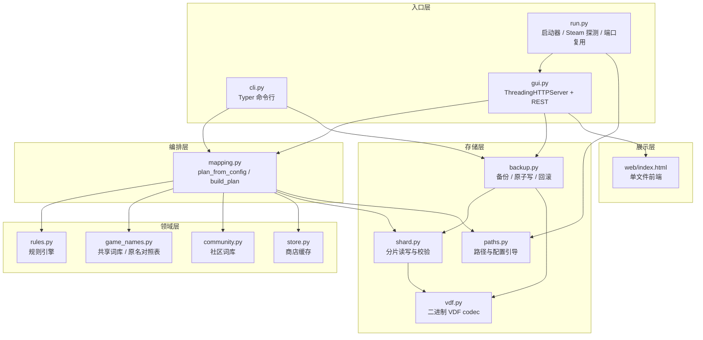
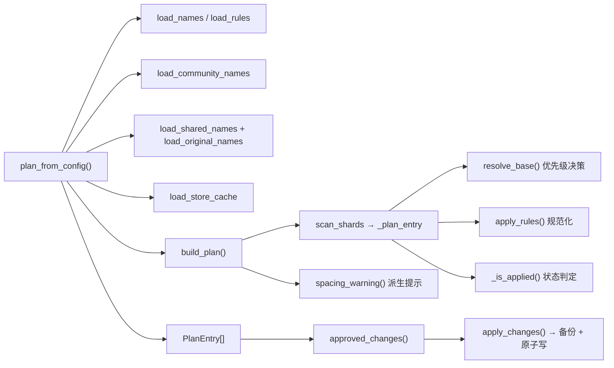
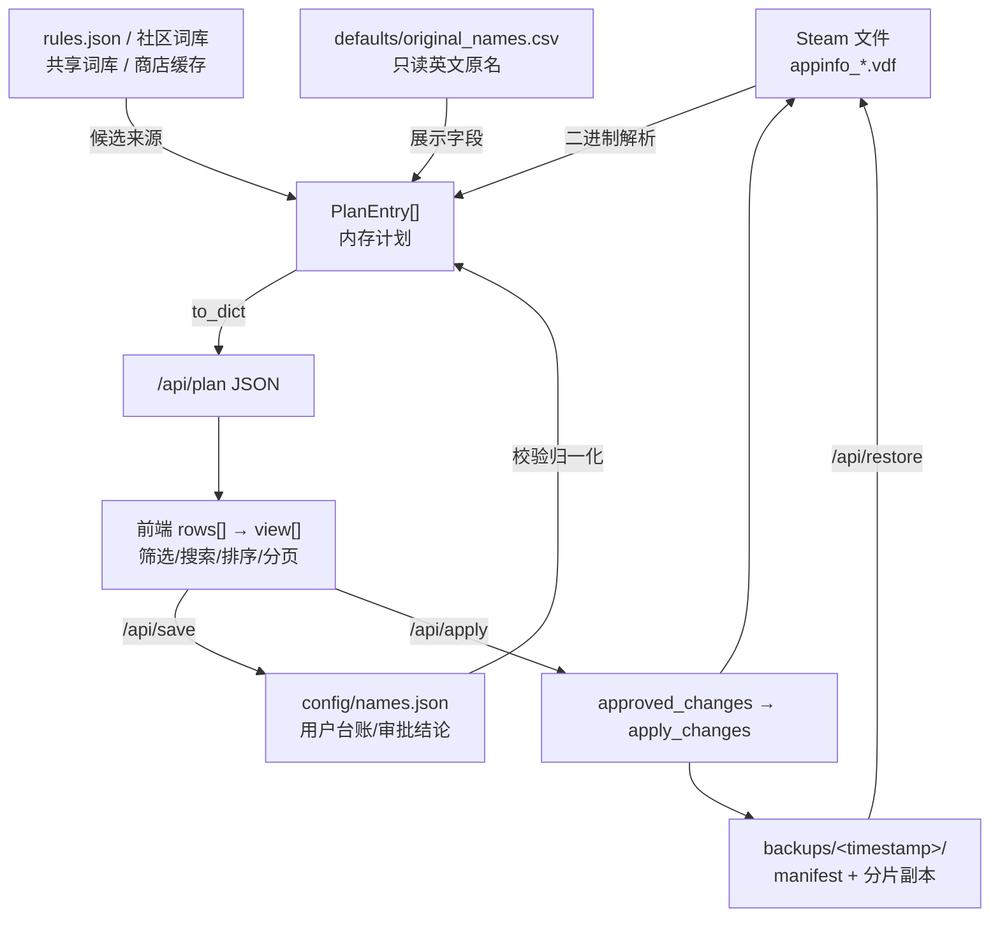
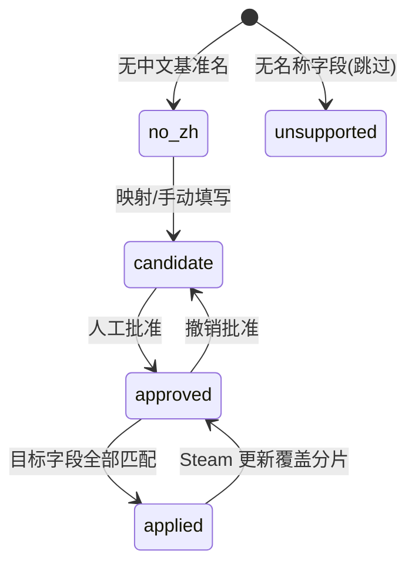
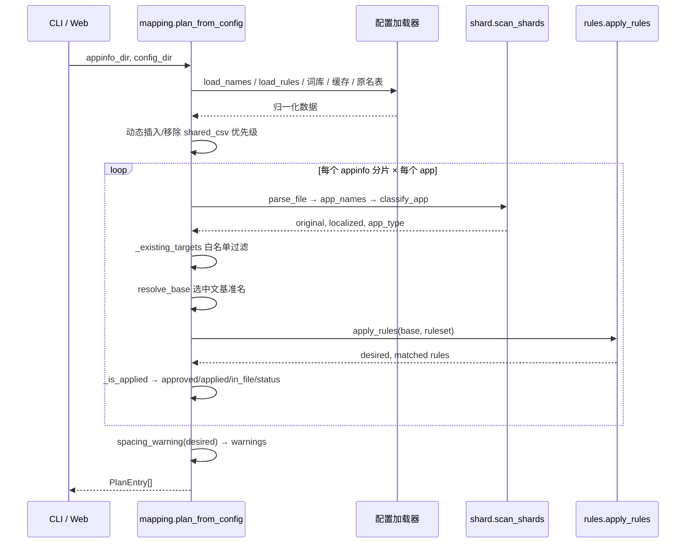

# Steam Game Rename 开发者说明

> 版本 0.5.0 · 面向维护与二次开发 · 最后校对基于当前源码

---

## 1. 项目概述

Steam Game Rename（早期名称「Steam 中文名编辑器」）是一个**纯本地**的 Steam 游戏名中文化工具。它直接读写 Steam 客户端缓存的二进制分片 `APPCache/APPInfo/appinfo_*.vdf`，把游戏显示名替换为人工审核过的中文名。

设计边界：

- **数据不出本机**。HTTP 服务只绑定 `127.0.0.1`；联网仅用于主动拉取社区词库（GitHub）与 Steam 商店译名，且失败不影响本地流程。
- **写入必须人工批准**。没有全自动改写通道；规则引擎只产出候选，`mode=auto` 会被加载器直接拒绝。
- **可逆**。每次写入前创建时间戳备份，写入过程中任何异常都会全量回滚。
- **双入口共用一套内核**。Typer CLI 与本地 Web UI 都调用同一个 `plan_from_config()` / `apply_changes()`，避免行为分叉。

项目采用扁平布局：`src/` 下直接是顶层模块，无包嵌套；`run.py` 在启动时把 `src/` 注入 `sys.path`。

---

## 2. 核心功能

| 功能 | 说明 |
|---|---|
| 分片扫描与解析 | 解析 appinfo v42 分片，提取 `common.name`、`name_localized.{schinese,sc_schinese}`、`common.type` |
| 多来源译名映射 | 按可配置优先级从七类来源选取中文基准名（见 §5.4） |
| 规则规范化 | 6 条有序规则处理英文尾巴、标点、空白、商标符号、中西文间距、书名号 |
| 审批工作流 | 候选 → 人工批准 → 写入；状态区分「已批准 / 已生效 / 文件中已存在」 |
| 安全写入 | 预检目标字段 → 备份 → 重建分片 → 内存二次校验 → 原子替换 → 失败回滚 |
| 备份与恢复 | SHA256 清单校验、时间戳恢复点、按时间倒序列出、保留策略清理 |
| 共享词库 | 随程序分发的 CSV 基线 + 本地覆盖 CSV，支持多人维护、Git diff |
| 本地 Web 编辑器 | 筛选 / 搜索 / 排序 / 分页 / 行内编辑 / CSV 导出 / 状态轮询 / 应用与恢复 |
| 静默同步 | `sync` 命令 / Web「静默同步」按钮：只补回 Steam 更新后丢失的已批准名称，不重复写入已生效项 |
| 自动沉淀英文名 | 启动时扫描分片，把本机独有非中文名写入 `learned_originals.csv`，作为只读展示的本地补充层 |
| 拼音排序键 | opt-in 写入 `common.sortas`（GB2312 首字母），让汉化游戏在 Steam 库按 A–Z 排列 |
| 优雅关闭/重启 Steam | `steam.exe -shutdown` 轮询等待退出 → 写入 → 重启；失败即中止，绝不强制 kill |
| Web 联网更新 | 工具栏触发社区词库更新 / 商店中文名补全，后台线程执行、前端轮询进度 |
| 排版提示 | 检测汉字与数字紧邻并提示加半角空格，**只警告不修改**（`src/vdf.py: spacing_warning`） |

---

## 3. 整体架构

系统分为五层，依赖方向自上而下，反向依赖仅通过 `re-export` 兼容层：



两种运行形态：

- **CLI**：`python run.py --no-browser` 启动 Web 服务；`python src/cli.py <command>` 执行批处理命令。
- **Web**：`run.py` 检测 Steam 目录、挑选空闲端口、打开浏览器，之后由 `gui.run_gui()` 常驻服务。

---

## 4. 技术栈、选型与职责

| 技术 | 版本约束 | 在本项目中的职责 | 选型理由 |
|---|---|---|---|
| Python | ≥ 3.11 | 全部后端逻辑 | 需要 `\|` 联合类型、`match` 等现代语法；Windows 上开箱即用 |
| Typer + Rich | ≥ 0.12 / ≥ 13 | CLI 参数解析、表格与彩色输出 | 声明式命令、类型提示即帮助文本；Rich 表格便于预览计划 |
| Pydantic v2 | ≥ 2 | `names.json` / `rules.json` 的 schema 校验与归一化 | 关键价值是**归一化**：避免 `"approved": "false"` 这类宽松真值在下游被误判为真 |
| httpx | ≥ 0.27 | 社区词库下载、Steam Store API 批量查询 | 支持超时、重定向、连接池与重试；比 `urllib` 更易控制 |
| `http.server` (标准库) | — | Web 服务 `ThreadingHTTPServer` | 零额外依赖、易审计；配合 loopback 绑定与 Host/Origin 校验已足够本地场景 |
| 原生 HTML/CSS/JS | — | 单文件前端 `index.html` | 无 Node 构建链、无框架依赖；随程序分发即可运行 |
| setuptools | ≥ 68 | 打包：`py-modules` + `data-files` | 扁平模块布局，静态资源安装到 `share/steam-cn-renamer/` |
| pytest | ≥ 8 | 单元 / API / 快照 / 往返测试 | fixture 固定、快照可 `UPDATE_SNAPSHOTS=1` 重生成 |

依赖被刻意压到 4 个第三方包。`run.py` 在导入失败时会打印明确的 pip 安装命令并返回退出码 4。

---

## 5. 关键技术原理

### 5.1 appinfo v42 分片格式

`src/shard.py` 模块头描述了布局（小端序）：

```
44 字节 header : magic(0x0756442A) universe shard shard_count app_count
                  index_size string_count string_size data_size index_crc header_crc
index region   : 每个 app 16 字节摘要(appid, offset, size, summary_size) + summary_size 字节
string table   : NUL 结尾的 UTF-8 键
data region    : 每个 app [20 字节 SHA1][二进制 VDF blob]，按 offset 连续排列
```

`parse_bytes()` 严格校验：magic、universe（必须为 1）、声明尺寸与实际长度相等、字符串表无残余、索引表无残余、每个 blob 的数据范围合法。`verify()` 进一步核对两层 CRC（索引+字符串表、header 前 40 字节）、数据区无空洞、每个 blob 的 SHA1、数据区总长。

> 注：模块 docstring 写的是「80-byte index entry per app」，实际解析按 `16 + summary_size` 变长处理，以代码为准。

### 5.2 二进制 VDF 编解码

`src/vdf.py` 实现 appinfo 使用的二进制 VDF：

- 键不是字符串本身，而是**指向文件级字符串表的 u32 索引**；值内联在节点后。
- `Node` 保留 `raw` 原始字节与 `trailer`，因此 parse → serialize 往返**字节精确**，这是安全重写的前提。
- 支持 STRING / WIDESTRING / INT32 / FLOAT32 / POINTER / COLOR / UINT64 / INT64 及对象节点。
- `_parse_node()` 有 64 层递归上限，防畸形数据导致的栈溢出。
- `resolve(codec, root, ["common", "name"])` 支持点分路径，`target_path()` 把 `name_localized.schinese` 映射为 `["common", "name_localized", "schinese"]`。
- `set_node_text()` 先经 `validate_name()` 拒绝 NUL、控制字符与超过 1024 字节的值，再以 `utf-8 + \x00` 写入。

### 5.3 完整性校验与原子写入

写入安全性由 `backup.apply_changes()` 统一保证：

1. Steam 进程检测（`tasklist /FI IMAGENAME eq steam.exe`，结果缓存 3 秒），默认要求完全关闭。
2. 分片名合法性校验（`Path(name).name == name`），防路径穿越。
3. `check_targets()` 预检每个目标路径真实存在——不存在的目标是配置错误，快速失败而非静默跳过。
4. `create_backup()` 复制所有分片到时间戳目录，写入 `manifest.json`（`manifest_version=1` + 每文件 SHA256）。
5. `shard.build_bytes()` 重建分片：重新序列化被改的 blob、重算 data offset/size、逐 blob 重算 SHA1、重算 index CRC（header 偏移 36）与 header CRC（偏移 40）、更新 data_size（偏移 32）。
6. 重建结果在内存中再次 `parse_bytes()` + `verify()` + `verify_changes()`，确认无误才落盘。
7. `atomic_write()`：同目录临时文件 → `fsync` → `os.replace`。
8. 任何异常触发 `restore_backup()` 全量回滚；回滚再失败时把两个异常一起报出。

### 5.4 译名优先级与初始英文名保护

`resolve_base()` 按 `defaults.mapping_priority` 顺序选取中文基准名。默认顺序：

```
user_override > shared_csv > local_schinese > local_sc_schinese
              > common_name > community > store_api
```

`common_name` 专门覆盖「appinfo 里 `common.name` 本身就是中文」的条目（如《秦殇》），避免误报「无中文名」。优先级中若出现未知来源直接抛 `ValueError`。

**初始英文名的保存**是一个独立设计：`original_name` 实时读 Steam 文件，一旦写入中文就不再是最初的英文名；台账里的 `original_name` 在历史版本中也已被覆盖。因此项目维护了一份只读对照表 `src/defaults/original_names.csv`（773 条），由 `game_names.load_original_names()` 加载，`PlanEntry.steam_original_name` 取「对照表值 or 台账残留值」。该字段**仅供展示与搜索**，不参与审批或写入判定。

### 5.5 缓存签名与失效

`gui._source_signature()` 收集所有分片与配置文件的 `(文件名, mtime_ns, size)` 作为签名，`plan_payload()` 按签名缓存序列化后的 JSON。未变化时直接返回缓存字节，变化时重算。典型场景下一次 `/api/plan` 从数百毫秒降到十余毫秒。签名纳入两份随包 CSV，因此更新词库也会自动使缓存失效。

---

## 6. 主要模块职责与调用关系

| 模块 | 职责 | 关键对外接口 |
|---|---|---|
| `run.py` | Steam 目录探测（参数 → 环境变量 → 配置文件 → 注册表 → 常见路径 → 盘符扫描）、端口复用、浏览器打开 | `main()`, `detect_steam_dir()`, `pick_port()` |
| `paths.py` | 路径解析、首次配置引导、资源定位（模块同级优先，`sys.prefix/share` 回退） | `asset_dir()`, `default_config_dir()`, `ensure_config()` |
| `vdf.py` | 二进制 VDF codec、名称校验、间距警告 | `BinaryVDF`, `resolve()`, `set_node_text()`, `spacing_warning()` |
| `shard.py` | 分片解析/重建/校验、名称字段提取、目标路径映射、新键追加 | `parse_file()`, `verify()`, `build_bytes()`, `build_bytes_with_new_keys()`, `check_targets()` |
| `backup.py` | 备份创建与校验、原子写、恢复、Steam 进程检测与优雅关闭/重启、写入编排 | `apply_changes()`, `create_backup()`, `steam_shutdown()`, `steam_start()` |
| `pinyin.py` | 零依赖汉字拼音首字母（GB2312 一级字库区位边界表） | `to_initials()`, `sortas_for()` |
| `db.py` | SQLite 存储层：schema、迁移、镜像、按需查询 | `ensure_db()`, `read_ledger()`, `query_community()` |
| `run_desktop.py` | 桌面壳：pywebview 窗口 + 托盘 + 退出后补写守护 | `main()`, `SteamGuard` |
| `rules.py` | 规则 schema 校验、有序执行、ReDoS 防护 | `load_rules()`, `apply_rules()` |
| `community.py` | 社区词库加载（JSON + CSV）与联网更新 | `load_community_names()`, `update_community_names()` |
| `store.py` | 商店中文名批量抓取与磁盘缓存（TTL 30 天） | `fetch_store_names()`, `load_store_cache()` |
| `game_names.py` | 共享词库两层合并、只读原名基线 + 本地学习层、导出、原名一致性校验 | `load_shared_names()`, `load_original_names()`, `merge_original_names()`, `write_learned_originals()`, `check_originals()` |
| `mapping.py` | **核心编排**：配置加载、计划生成、优先级决策、审批分组、静默同步、原名沉淀、拼音排序键 | `plan_from_config()`, `build_plan()`, `approved_changes()`, `pending_changes()`, `learn_original_names()` |
| `cli.py` | 15 个 Typer 命令、退出码归一、计划任务安装 | `main()`, `task_command()` |
| `gui.py` | loopback HTTP 服务、14 个 API、联网后台任务、请求校验、计划缓存 | `make_handler()`, `run_gui()`, `plan_payload()` |
| `version.py` | 单一版本源，供 `/api/status` 与页面徽标读取 | `__version__` |

模块间的兼容层：`mapping.py` 从 `community.py` / `store.py` 重新导出 `load_community_names`、`update_community_names`、`fetch_store_names` 等，供 CLI / GUI / 测试沿用旧导入路径。



---

## 7. 数据与状态流转

### 7.1 数据分层



### 7.2 PlanEntry 状态语义

`PlanEntry` 是贯穿全链路的核心数据结构。状态字段的语义必须区分：

| 字段 | 含义 |
|---|---|
| `original_name` | Steam 文件**当前**名称（可能已是中文） |
| `steam_original_name` | 最初英文名，只读展示字段 |
| `base_name` | 经优先级选中的中文基准名 |
| `desired_name` | 规则处理后的目标名（或台账中已批准的名字） |
| `approved` | 台账中是否批准 |
| `in_file` | 所有目标字段是否都已等于 `desired_name` |
| `applied` | `approved and in_file`，即「批准且已生效」 |
| `status` | `approved` / `candidate` / `no_zh` / `unchanged` / `unsupported` |
| `warnings` | 派生提示（间距建议、词库原名不符），**不写回台账** |

状态的产生分支见 `_plan_entry()`：无主名称字段 → `unsupported`；手动覆盖 → 按 `desired_name` 决定 `approved/candidate/no_zh`；无中文基准名 → `no_zh`；台账已批准 → `approved`；否则规则结果与目标不同为 `candidate`，相同为 `unchanged`。

前端 7 张统计卡：本类条目、已批准、规则候选、无中文名、无需改动、不支持、当前显示。注意「已批准」按 `approved` 标志统计，与其他按 `status` 分类的卡片口径存在包含关系，不可直接相加。

### 7.3 写入状态机



---

## 8. 核心实现流程

### 8.1 计划生成



### 8.2 写入与回滚

`approved_changes()` 只收集 `approved=True`、`desired_name` 非空、`status != unsupported` 且 `targets` 非空的条目，按分片分组为 `{shard: {appid: {target: value}}}`。`apply_changes()` 随后按 §5.3 的流程执行。CLI 的 `apply` 默认 dry-run，必须显式 `--execute`；Web 的 `/api/apply` 直接写入但会先拒绝 Steam 运行中的请求（HTTP 409）。

### 8.3 新用户首次启动

1. `run.py` 探测 Steam 目录（要求 `APPCache/APPInfo` 存在；仅有 `steamapps` 的库目录会给出专门提示）。
2. `ensure_config()` 从 `src/defaults/` 复制 `names.json` 与 `rules.json` 到配置目录（只复制缺失文件，不覆盖已有）。
3. 空台账 + 共享词库基线（206 条）→ 新用户直接获得已审核的中文名；老用户已批准的条目优先，不被覆盖。
4. 若需停用共享词库，在 `names.json` 的 `defaults` 中设置 `"use_shared_names": false`。

### 8.4 Web 请求处理

`gui.make_handler()` 内建 `Handler`，所有请求先经 `_guard()`：重置 `_responded` 标志，捕获异常，若尚未响应才发 500，避免半途异常导致双响应或泄漏 traceback。GET/POST 都先做 Host/Origin 校验（仅允许 `127.0.0.1:{port}` 与 `localhost:{port}`）。

| 方法 | 路径 | 作用 |
|---|---|---|
| GET | `/` | 返回单文件前端 |
| GET | `/api/status` | app 标识、版本、Steam 运行状态、端口、目录 |
| GET | `/api/backups` | 备份列表（含文件数、体积、创建时间） |
| GET | `/api/defaults` | 读取 `names.json.defaults`（写入策略） |
| GET | `/api/plan` | 带签名缓存的计划 JSON |
| GET | `/api/task` | 联网后台任务进度（running/kind/done/total/message/error） |
| POST | `/api/save` | 保存台账编辑；校验 `targets` 白名单与名称合法性 |
| POST | `/api/defaults` | 更新写入策略；字段白名单 + 类型校验，保存后清计划缓存 |
| POST | `/api/apply` | 审批写入（要求 Steam 关闭） |
| POST | `/api/sync` | 静默补写未生效的已批准项 |
| POST | `/api/apply-safe` | 优雅关闭 Steam → 写入 → 重启（opt-in，Steam 运行时用） |
| POST | `/api/update-community` | 后台下载社区词库 |
| POST | `/api/fetch-store` | 后台补全商店中文名（`limit` 1–500） |
| POST | `/api/restore` | 从指定备份恢复（校验备份名无路径） |
| POST | `/api/shutdown` | 异步关闭服务 |

请求体上限 5,000,000 字节，非 JSON 对象或非数字 `Content-Length` 均返回 400。前端以 30 秒轮询 `/api/status` 更新 Steam 运行状态。

---

## 9. 配置说明

### 9.1 路径与环境变量

| 项 | 解析顺序 |
|---|---|
| 资源目录 `asset_dir()` | 模块同级目录 → `sys.prefix/share/steam-cn-renamer/<name>` |
| 配置目录 | `STEAM_CN_CONFIG` → 项目 `config/`（存在时）→ `%APPDATA%/steam-cn-renamer` |
| 备份目录 | `STEAM_CN_BACKUPS` → 项目 `backups/`（存在时）→ `%LOCALAPPDATA%/steam-cn-renamer/backups` |
| Steam 目录 | CLI/Web 参数 → `STEAM_DIR` → `launcher.json` → 注册表 → 常见安装路径 → 盘符扫描 |

`launcher.json` 由启动器写入 `steam_dir`、`port`、`detected_by`，位于项目根目录；默认端口 8765，占用时从 8765 起最多尝试 20 个端口，已运行实例会被复用（`--force-new` 可强制新起）。

### 9.2 names.json（台账）

`schema_version: 1`。顶层含 `meta`、`defaults`、`summary`、`entries`。

`defaults` 关键字段：

```json
{
  "review_required": true,
  "primary_target": "common.name",
  "sync_existing_localized": ["schinese", "sc_schinese"],
  "create_missing_localized": false,
  "use_shared_names": true,
  "mapping_priority": ["user_override", "shared_csv", "local_schinese",
                       "local_sc_schinese", "common_name", "community", "store_api"]
}
```

`entries` 以 AppID 字符串为键，字段包括 `appid`、`shard`、`original_name`、`base_name`、`desired_name`、`applied_rules`、`source`、`targets`、`status`、`approved`、`manual_override`、`note`、`app_type` 等。加载时会校验 key 为数字、`entries[key].appid` 与 key 一致、`targets` 全部通过白名单。**写入目标白名单**：仅 `common.name` 或 `name_localized.<语言>`（语言后缀 `[a-z_]{2,20}`），防止误写 `common.icon` 等元数据字段。

`summary.entries_in_file` 由 `/api/save` 自动维护。

### 9.3 rules.json（规则）

`schema_version: 1`，`execution.order` 决定执行顺序，默认 6 条规则：R1 去英文尾巴、R2 半角标点转全角、R3 清理空白、R4 去商标符号、R5 中西文间距、R6 去书名号。每条规则含 `enabled`、`mode`、`preconditions`、`operations`。

加载约束：正则长度 ≤ 500 字符（防 ReDoS）、flags 仅允许 `i/m/s/x`、`order` 引用的规则必须存在、未列入 `order` 的规则发出警告、**任何 `mode=auto` 都会抛错**。规则只作用于已确定为中文的候选名，纯英文名必须先经译名映射。

### 9.4 词库与对照表

| 文件 | 位置 | 作用 |
|---|---|---|
| `game_names.csv` | `src/defaults/`（基线）+ `config/`（本地覆盖，可选） | 共享词库；列 `GameID,OriginalName,ModifiedName,Source,UpdatedAt,Enabled,Note`；UTF-8 BOM；`Enabled=false` 停用；重复 GameID 后者覆盖前者 |
| `original_names.csv` | `src/defaults/`（只读） | 最初英文原名对照表，773 条，仅供展示与搜索，程序永不改写 |
| `learned_originals.csv` | `config/`（程序维护） | 启动时自动沉淀的本机独有英文名（`GameID,OriginalName`），作为只读展示的本地补充层 |
| `community_names.json` | `config/` | SteamGameName 格式 `{games: {appid: name}}`，可由 `update-community` 联网更新；同名 `.csv` 作为覆盖层 |
| `store_cache.json` | `config/` | `{appid: {name, fetched_at}}`，TTL 30 天，由 `fetch` 命令写入 |

CSV 读取兼容 UTF-8 BOM / UTF-16 / GBK；解析失败不会静默返回空表，最后兜底用 `replace` 解码并保留警告。

### 9.5 CLI 命令

`python src/cli.py [全局选项] <命令>`，全局选项 `--steam-dir`、`--config-dir`、`--backup-root`。可用命令：

`scan`、`plan`（`--all` / `--json` / `--type`）、`verify`、`apply`（默认 dry-run，`--execute` 落盘）、`sync`（静默补写未生效的已批准项；`--auto-restart` 关闭重启、`--skip-if-running` 静默跳过）、`learn-originals`（沉淀本地英文名）、`restore`（`--backup`）、`backups`、`prune-backups`（`--keep`，默认 8）、`fetch`（`--limit`）、`update-community`、`export-mappings`（`-o`，导出共享 CSV）、`validate-mappings`、`install-task`（`--daily HH:MM`）、`uninstall-task`。

退出码由 `main()` 归一：`CliExit`/`typer.Exit` 保留原码，`BadParameter`、`BackupError`、`ValueError`、`FileNotFoundError`、`OSError` 统一为 1。

---

## 10. 已知限制

- **格式与平台**：只支持 appinfo v42（magic `0x0756442A`，universe 1）；Steam 进程检测、注册表探测面向 Windows，非 Windows 下 `steam_running()` 恒为 `False`。
- **审批刚性**：所有改名必须人工批准，未开放自动写入；`mode=auto` 配置会被拒绝加载。
- **不可写条目**：部分 DLC 在 Steam 数据里没有名称字段，标记为 `unsupported` 并跳过，不参与写入。
- **Steam 必须关闭**：写入与恢复默认要求 Steam 完全退出（含托盘）；`--allow-running` 可绕过，但不推荐，Steam 可能在退出时回写缓存。Web 端提供 opt-in 的「自动安全关闭并重启」：走 `steam.exe -shutdown` 轮询等待，20 秒未退出即中止写入，绝不强制 kill（避免云存档损坏）。
- **英文名覆盖不完整**：只读基线 `original_names.csv` 覆盖 773/803 条；另有本地学习层 `learned_originals.csv` 在启动时自动沉淀本机独有的非中文名。原本就以中文命名的游戏没有英文原名记录，前端回退显示当前名。基线需随版本手动维护。
- **联网功能可失败**：商店 API 批量请求失败会重试 3 次后静默跳过，社区词库下载失败抛 `ValueError`；两者都不影响本地计划生成。
- **服务安全边界**：Web 服务无认证，仅靠 loopback 绑定与 Host/Origin 校验；不要暴露到局域网或公网。
- **并发**：写操作由进程内 `threading.Lock` 串行化；联网后台任务用独立的 `task_lock`。启动器会复用已有实例，但没有跨进程文件锁（CLI 与 Web 同时写入仍可能冲突）。
- **缓存失效粒度**：`_plan_cache` 与分片缓存均按文件 `mtime_ns` + `size` 签名，若外部修改文件却保持两者不变，缓存不会刷新（`prune-backups` 不影响此逻辑）。
- **SQLite 与 JSON 可能短暂不一致**：`save_names()` 先提交 db 事务再写 JSON 镜像；若镜像写入失败（磁盘满/权限），db 已是新值而 JSON 是旧值。加载以 db 为准，因此不影响正确性，但手工查看 JSON 会看到旧内容。恢复方式：删除 `renamer.db` 后重新保存一次即可由 JSON 重建。
- **db 并发**：SQLite 使用 WAL + `timeout=10`，可承受同进程多线程；跨进程（CLI 与 Web 同时写）仍可能遇到 `database is locked`，与既有的跨进程锁缺失是同一限制。
- **Steam 仍会覆盖部分汉化**：实测 26 次启动中 65% 会写分片（多在服务器端有 app 更新时），被覆盖的通常是 1–20 个分片，`sync` 可精确补回。详见 §13.3。程序不会自动运行，需用户手动同步、装计划任务或（未来的）托盘守护。
- **备份清理**：`prune_backups()` 只处理备份根目录下直接包含 `manifest.json` 的子目录，`keep=0` 会报错。
- **规则与输入上限**：单条正则 ≤ 500 字符；写入名称 ≤ 1024 字节且不含控制字符；Web 请求体 ≤ 5 MB。
- **前端窄屏**：表格在 760px 以下改为横向滚动（最小宽度 760px），而非重排为卡片，编辑列始终可用。

---

## 11. v0.4.3 新增能力

本章记录相对 0.4.2 的四项增量，均保持"人工批准才写入、数据不出本机、失败可回滚"的既有边界。

### 11.1 静默同步（sync）

Steam 更新游戏或重启客户端拉取元数据后，会重写 appinfo 分片，使已批准的名称从"已生效"退回"已批准"。此时无需重新打开审批流程，只需补写：

- **判定**：`pending_changes(plan)` 只挑 `approved && !in_file && status != unsupported` 的条目，已生效项不重复写入。
- **CLI**：`python src/cli.py sync` 默认 dry-run，`--execute` 才真正备份写入；`--allow-running` 可绕过 Steam 检测（不推荐）。
- **Web**：顶栏「静默同步」按钮调用 `/api/sync`，同样复用 `apply_changes()` 的备份 + 校验 + 回滚链路。
- **安全**：只针对已批准项，不重新审批、不改台账；Steam 运行时返回 409 拒绝。

### 11.2 自动沉淀英文名（learned_originals.csv）

只读基线 `defaults/original_names.csv`（随版本分发、程序永不改写）之外，新增本机补充层：

- **来源**：`learn_original_names()` 扫描分片，把当前 `common.name` 为非中文、且基线未覆盖的 AppID 写入配置目录的 `learned_originals.csv`（UTF-8 BOM）。
- **触发**：CLI `learn-originals` 命令；Web 服务启动时后台线程自动执行一次（失败静默，绝不影响主流程）。
- **合并**：`merge_original_names()` 用基线覆盖学习层（基线优先），仅供 `steam_original_name` 展示与搜索，**不参与**目标解析与写入。
- **意义**：新游戏、地区限定名在日常使用中自动沉淀，降低基线手动维护成本。

### 11.3 拼音排序键（common.sortas）

Steam 库按 `common.sortas` 字符串排序。汉化后若该字段为空，游戏会按中文 Unicode 码乱序排列。

- **开关**：`defaults.write_sortas_pinyin`（默认 `false`，opt-in）。开启后，`build_plan()` 给已批准条目计算 `sortas`。
- **转换**：`pinyin.py` 用 GB2312 一级字库的拼音有序特性做区位边界二分查找，零第三方依赖；常用汉字转大写首字母（猛兽派对 → `MSPD`）。二级字库（按部首排）无法用此法推断，保留原字而非猜测，避免误导排序。
- **写入路径**：真实数据 803 条里仅 7 条有 `sortas` 字段，故多数条目需要新增键。`build_bytes_with_new_keys()` 把新 key 追加到分片 string table 末尾——既有 key 索引全部不变——再在 `common` 下插入 string 子节点，最后重算数据区 SHA1、索引偏移、双层 CRC。`check_targets(..., allow_create={"common.sortas"})` 放行缺失目标，`apply_changes()` 按 changes 自动选择新旧构建路径。
- **字节精确保障**：新增键后 `verify()`（index CRC + header CRC + 每 app SHA1）与 `verify_changes()` 均通过；未改动的 app blob 逐字节不变；原子写 + 失败回滚链路不变。

### 11.4 优雅关闭与重启 Steam

Web 应用写入弹窗在检测到 Steam 运行时，额外提供"自动安全关闭 Steam，写入完成后重启"选项：

- **端点**：`/api/apply-safe` 接收 opt-in 信号，流程为 `steam_shutdown(exe)` → `apply_changes()` → `steam_start(exe)`，全程持有写锁。
- **优雅退出**：`steam_shutdown()` 调用 `steam.exe -shutdown`，每 0.5 秒轮询 `steam_running()`，20 秒超时即返回 False 并中止写入。绝不 `taskkill`，避免云存档损坏。
- **失败处理**：关闭失败返回 409 并提示手动退出；写入失败走既有回滚；重启失败返回 `restarted: false`，提示用户手动启动。
- **边界**：CLI `apply --allow-running` 仍是绕过通道（不推荐）；该选项不写入台账、不影响审批状态。

### 11.5 Web 联网更新入口

- **端点**：`POST /api/update-community`（下载社区词库）、`POST /api/fetch-store`（按 limit 补全商店中文名）、`GET /api/task`（进度）。
- **执行**：后台线程 + 独立 `task_lock`，同一时刻只允许一个联网任务；完成/失败后清空 `/api/plan` 缓存使签名失效。
- **前端**：工具栏「词库更新」弹窗，轮询进度条；任务进行中禁用按钮，结束后自动刷新计划。
- **安全**：沿用 Host/Origin 校验；联网失败写入 `task_state.error`，不影响本地计划生成。

---

## 12. v0.4.4 修复与增强

### 12.1 三个边缘漏洞修复

1. **原名学习污染**：`learn_original_names()` 现在读取 `names.json`，跳过 `approved=True`、`manual_override=True` 或 `desired_name` 非空的 AppID。此前用户把《Counter-Strike 2》改成别名 `CS2` 后，后台学习会把这个纯英文别名当成"最初英文名"写入 `learned_originals.csv`。台账缺失或损坏时静默降级为"只学纯净条目"，不阻断主流程。
2. **CLI `apply` 预检漏放行**：第 183 行的 `check_targets()` 此前未传 `allow_create`，开启 `write_sortas_pinyin` 后 `apply --execute` 会在预检阶段报"目标字段不存在: common.sortas"。现改为与 `sync`、`backup.py` 共用 `backup.CREATABLE_TARGETS` 常量，杜绝三处定义漂移。
3. **`sync` 无法在 Steam 运行时工作**：CLI 增加 `--auto-restart`（`steam_shutdown` → 写入 → `steam_start`，关闭失败即中止，写入异常也保证拉起 Steam）；`/api/sync` 接受 `{"auto_restart": true}` 并兼容旧前端的无请求体 POST。前端在 Steam 运行时先弹出云存档风险确认。新增 `--skip-if-running`：Steam 运行时安静跳过并以 0 退出，供计划任务使用。

### 12.2 静默守护任务

- `install-task` / `uninstall-task`：通过 `schtasks /Create|Delete` 管理任务 `SteamCNRenamer_Sync`，默认 `ONLOGON` 触发，`--daily HH:MM` 可改为每日定时。
- 任务命令由纯函数 `task_command()` 生成：使用 `pythonw.exe`（无控制台）+ `sync --execute --skip-if-running`。路径含引号或 `%` 时直接拒绝，防止 `/TR` 参数注入。
- 设计边界：只在 Steam 未运行时补写；运行中不打扰玩家，等下次登录再补。任务不会自行重新安装依赖，也不会绕过审批——只写台账中已批准的条目。

### 12.3 Web 写入策略配置栏

- `GET /api/defaults` 返回 `names.json.defaults`；`POST /api/defaults` 只接受字段白名单（`review_required`、`primary_target`、`sync_existing_localized`、`create_missing_localized`、`write_sortas_pinyin`、`mapping_priority`），带类型/语言代码/目标合法性校验，保存后清空 `/api/plan` 缓存。
- 前端「写入策略」弹窗可视化勾选 `tchinese` 简繁同步、`write_sortas_pinyin` 拼音排序、`create_missing_localized`，无需手工编辑 JSON。所有改动仍走 `load_names()` 的 Pydantic 校验，且不影响已有审批状态。

### 12.4 原名表自动更新流水线

- `scripts/update_original_names.py`：从 Steam `ISteamApps/GetAppList/v2/` 拉取全量 AppID/名称，只追加 CSV 中缺失且为纯 ASCII 名称的条目，默认上限 200 条，支持 `--dry-run`。
- **绝不覆盖已有行**：本表记录"最初英文名"，而 AppList 返回的是当前名（可能已改名）；覆盖会破坏语义。
- `.github/workflows/update-db.yml`：每周一 03:00 UTC 运行并自动开 PR。当前工作目录不是 git 仓库，需推送到 GitHub 后才会生效。

---

## 13. v0.4.5 性能优化与 Steam 重写实测

### 13.1 分片增量缓存

`mapping.scan_shards()` 现在按 `(mtime_ns, size)` 缓存已解析的 `Shard`，用 `_shard_cache_lock` 保护。命中条件要求两项指纹完全一致，任一变化即重新解析——写入后文件 mtime 必变，因此不存在"读到过期树"的窗口。

实测（247 个分片 / 2.6 MB / 803 条）：

| 场景 | 耗时 |
|---|---|
| 冷启动（全量解析） | 349 ms |
| 稳态（缓存全命中） | **19 ms** |
| Steam 只改 1 个分片 | **20 ms**（只重解析那 1 个） |

`Shard` 一旦缓存即视为不可变：`build_bytes()` 会重新解析每个 blob 再改，不会原地修改缓存树。`clear_shard_cache()` 供测试与手工干预使用。

`vdf.Node` 同时改为 `@dataclass(slots=True)`，省约 3% 解析时间与一部分对象内存；收益小但无风险。

### 13.2 三个被实测否决的方案

记录在此，避免后续重复尝试：

1. **线程池并行解析**：8 线程 240 ms vs 串行 221 ms，**慢 8%**。解析是 CPU 密集型纯 Python 字节操作，GIL 下线程只增加切换开销。
2. **按 shard 名按需解析**：只解析"台账中已批准条目所属的 159 个分片"，实测仅省 17%（148→123 ms）。原因是这 159 个分片占 88% 字节量，未选中的 88 个都是 4 KB 级小文件。更重要的是存在**正确性风险**：Steam 重组分片后台账里的 `shard` 字段会过期，按名字过滤会永久漏掉迁移到其他分片的游戏。已放弃。
3. **pickle 缓存解析结果**：反序列化 258 ms（只比重新解析快 27%），还要 193 ms 序列化与 9.9 MB 磁盘占用。不划算。

结论：解析成本是硬性的（2.6 MB → 145 ms），唯一可行方向是**减少重复解析次数**，即 13.1 的增量缓存。

### 13.3 Steam 何时重写 appinfo —— 基于 `logs/appinfo_log.txt` 的实测

统计该机 26 次 Steam 启动（2026-11-22 ~ 11-24）：

| 行为 | 次数 | 占比 |
|---|---|---|
| 完全不写分片 | 9 | 35% |
| 写 1–20 个分片（服务器端有 app 更新） | 12 | 46% |
| 全量重写 247 个分片 | 5 | 19% |

关键结论：

- **纯启动不一定覆盖**：9 次启动只有 `ThreadedReadShards` 读取、无任何写入，汉化不会被重置。
- **覆盖是按 appid 粒度的**：日志 `apps updated 1` 对应 `App cache succeeded writing 2 shards (11 apps)`。真正被覆盖的通常只有 1–20 个分片，`pending_changes()` 能精确补回。
- **全量重写由缓存重建引起**，不是改名的必然后果：日志显示这些会话伴随 `full data, 1024 prev attempts` 与 `Requested 7 app access tokens, 0 received, 7 denied`——是 token 被拒导致的反复重试与缓存重建（多见于家庭共享/区域受限条目），与写入 name 字段无关。
- **改名不会破坏 change number 校验**：change number 存在 `packageinfo.vdf`，appinfo 分片本身不携带，因此改 `common.name` 不会被 Steam 判定为"本地数据过期"。

对"托盘守护"方案的含义：**"Steam 退出后补写"有效但不完美**——它能维持到下次 Steam 因更新重写那几个分片为止。要做到"永不回退"，需要在 Steam 启动前补写（启动器包装），而不是退出后补写。两者可叠加。

---

## 14. SQLite 存储层（v0.4.6 引入，v0.5.0 定型）

### 14.1 分工：谁读 db、谁读文件（v0.5.0 定型）

实测（见 14.2 / 14.5）得出一个反直觉但可复现的结论：**同一份数据，"全量加载"时 JSON 更快，"按需查询"时 db 更快**。因此按访问模式分工，而不是一律入库：

| 数据 | 访问模式 | 主存储 | 理由 |
|---|---|---|---|
| `ledger`（台账） | 每次全量加载 | **JSON** | 803/3000/8000 条时 JSON 比 db 快 47–115%（7.2/26.5/80.3 vs 15.5/45.6/117.7 ms）；且需要人工编辑与 Git diff |
| `community` / `store_cache` | 只查本机 appid | **SQLite** | 按需 `IN` 查询恒定 ~0.6 ms，与词库规模无关 |
| `original_names` | 只查本机 appid | **SQLite** | 同上；`(appid, source)` 联合主键让 baseline 与 learned 共存 |
| `shared_names` | 全量（需校验警告） | **SQLite** | 206 条，但仍走 db 以统一写入与警告存储 |
| `rules.json` | 小、需可编辑 | **JSON** | 7 KB，规则必须人类可读可改 |

关键约定：

- 所有对外函数**签名不变**（`load_names(path)` / `load_shared_names(baseline, local)`），内部自行判定走 db 还是文件，调用点零改动。
- `save_names()` 写 JSON 的同时把台账同步进 `ledger` 表；**删掉或损坏 `names.json` 时能从 db 恢复**（实测：删文件后仍读回 803 条）。
- 台账 JSON **解析失败**才回退 db；**校验失败**（Pydantic / 非法 target）直接报错——否则用户手改错的台账会被旧 db 悄悄覆盖，看起来像"改了个寂寞"。
- 删除 `renamer.db` 即回到纯文件行为，无需改代码。
- `ensure_config()` 负责首次迁移（幂等），失败只告警不阻断。
- 测试通过 `STEAM_CN_RENAMER_NO_DB=1` 保持纯文件路径，避免污染 fixtures。

### 14.2 为什么必须按需查询（关键实测）

**全量加载时 SQLite 并不比 JSON 快**，这是反直觉但可复现的事实：

| 词库规模 | JSON 全量加载 | SQLite 全量 `SELECT` |
|---|---|---|
| 1 千条 | 0.6 ms | 5.7 ms |
| 2 万条 | 9.1 ms | 18.8 ms |
| 10 万条 | 48.6 ms | 72.0 ms |

原因：`json.loads` 是 C 实现，而 `sqlite3` 逐行构造 Python 对象更慢，且每次 `connect()` 有固定开销。

SQLite 的价值只在**按需查询本机拥有的 appid**（`WHERE appid IN (...)`，主键索引）：

| 词库规模 | JSON 全量 | SQLite 按需（803 appid） |
|---|---|---|
| 1 万条 | 4.5 ms | 1.09 ms |
| 10 万条 | 50.8 ms | 1.19 ms |
| 40 万条 | **250 ms** | **1.07 ms** |

因此 `plan_from_config()` 在 db 存在时先扫描分片拿到 appid 集合，再批量查四张表，而不是全量加载。完整 plan 实测（10 万条词库）：65 ms → 38 ms，且计划结果逐条一致（差异 0）。

### 14.3 已验证的安全边界

- **迁移无损**：用真实 803 条台账副本迁移，逐字段比对 `entries/defaults/summary/meta`，差异条目 **0**。
- **写入一致**：`save_names()` 同时更新 db 与 JSON 镜像；`update_community_names()` / `fetch_store_names()` 写文件后同步 db，避免"写文件、读 db"读到旧值。
- **社区 CSV 覆盖层仍生效**：按需查询后仍合并手工放置的 `community_names.csv`。
- **baseline 优先于 learned**：`query_originals()` 用 `ORDER BY CASE source WHEN 'baseline' THEN 0 ELSE 1 END` + `setdefault` 保证语义与 `merge_original_names()` 一致（此处的单主键设计缺陷已修复并加回归测试）。

### 14.4 v0.4.9：shared / original 读取路径已切到 db

- **`load_shared_names()`** 现在 db 优先。`sync_shared_from_files()` 用两个 CSV 的 `mtime_ns` 指纹判断是否需要重新导入——否则用户改了 `game_names.csv` 要重启才生效，是相对"每次读 CSV"的明显退化。校验警告（重复行、格式问题）一并存进 `meta.shared_warnings`，切库后不丢提示。
- **`load_shared_names_from_files()`** 保留为纯 CSV 解析入口，供迁移自身调用，避免"库优先"读到自己的旧值。
- **`learn_original_names()`** 的 baseline / learned 也走 db，新学到的名字同时写 CSV（交换格式）与 `original_names` 表。
- **`original_names` 表用 `(appid, source)` 联合主键**：同一游戏可同时有 baseline 与 learned，`query_originals()` 按 `baseline` 优先返回，与 `merge_original_names()` 语义一致。

**代价（如实记录）**：当前规模（994 条词库 / 773 条原名）下，db 路径的完整 plan 比纯 CSV **慢约 18 ms**（23 ms → 41 ms）——多了一次 `connect` 与 3 次 `IN` 查询，而解析 35 KB JSON 本来就只要 5 ms。这是为规模买的保险：40 万条词库时 JSON 需 250 ms，db 恒为 ~1 ms。

`rules.json` 保持文件——规则需要可读可编辑，且只有 7 KB。

### 14.5 台账为什么回到 JSON（v0.5.0）

台账是唯一"每次都必须全量加载"的数据，恰好落在 SQLite 的劣势区。实测（同结构、同字段的合成台账）：

| 台账条数 | JSON 大小 | JSON 读取 | db 读取 | 差异 |
|---|---|---|---|---|
| 803 | 0.4 MB | **7.2 ms** | 15.5 ms | db 慢 115% |
| 3000 | 1.7 MB | **26.5 ms** | 45.6 ms | db 慢 72% |
| 8000 | 4.5 MB | **80.3 ms** | 117.7 ms | db 慢 47% |

差距来源：`json.loads` 是 C 实现，一次解析直接得到 dict；`sqlite3` 需要逐行构造 16 个字段的 Python 对象再拼装。台账越宽（字段越多）、行数越多，db 越吃亏。

**交叉点在哪（词库侧）**：

| 词库规模 | JSON 全量 | db 按需（803 appid） |
|---|---|---|
| 1000 | **0.6 ms** | 0.80 ms |
| 5000 | 1.8 ms | **0.61 ms** |
| 20000 | 8.3 ms | **0.63 ms** |
| 100000 | 49.2 ms | **0.64 ms** |
| 400000 | 261.1 ms | **0.63 ms** |

大致规律：**词库条数约为本机 appid 数的 2–3 倍时，db 开始反超**；此后 JSON 线性增长，db 恒定。当前 994+773+206 ≈ 2000 条 vs 803 个 appid，正卡在交叉点附近，所以完整 plan 仍有约 7 ms 差距（22 ms → 29 ms）——这是为"游戏多、词库大"的用户留的余量，而不是退步。


---

## 15. v0.4.7 桌面壳

### 15.1 结构

`run_desktop.py` 把同一套 loopback 服务包进原生窗口，HTTP 层一行未改：

```
run_desktop.py
├── ThreadingHTTPServer(127.0.0.1, port=0)   # 复用 make_handler，端口自动分配
├── SteamGuard                                # 守护线程：运行→退出 边沿补写
├── pystray.Icon（run_detached）              # 托盘菜单
└── webview.create_window → webview.start()   # 主线程阻塞
```

- **写锁共享**：`make_handler(..., write_lock=...)` 新增可选参数，托盘触发的同步与 Web 的「应用写入」共用同一把 `threading.Lock`，不会并发写同一分片。
- **依赖降级**：`missing_desktop_deps()` 检测 `webview/pystray/PIL`，缺失时打印原因并调用 `run.main([])` 回退浏览器模式；`webview.start()` 抛错时同样回退。`启动桌面版.bat` 会先尝试 `pip install`，失败再降级。
- **退出清理**：`finally: shutdown()` 依次停守护、停托盘、关服务，避免残留幽灵进程。

### 15.2 为什么用轮询而不是 watchdog

`watchdog` 只能监听**文件系统**。监听 `APPCache` 目录会在 Steam **正在写**分片时触发——恰是我们必须退避的时刻；而监听"Steam 进程退出"它做不到（需要 psutil 或 WMI）。

因此守护用 `steam_running(ttl=0)` 每 30 秒轮询一次（`tasklist` 约 50 ms，即 0.17% CPU），只在**运行→退出**的边沿动作：

```python
@staticmethod
def should_sync(was_running, running) -> bool:
    return bool(was_running) and not running   # 初始 None 不触发
```

启动时若 Steam 未运行，先补一次（把上次被覆盖的汉化写回），然后进入边沿监听。`interval` 有 5 秒下限，防止把轮询设得过密。

### 15.3 验证状态

| 项目 | 状态 |
|---|---|
| pywebview 窗口创建→销毁→`start()` 返回 | **实测通过**（Python 3.12 + pywebview 6.2.1） |
| 托盘图标生成（PIL 几何绘制，无外部资源） | 单测通过（PNG 头校验） |
| 边沿判断 / 间隔下限 / Steam 运行中跳过 | 单测通过 |
| 依赖缺失回退、`--check` 自检 | **实测通过** |
| 关闭按钮收进托盘（`events.closing` 返回 False） | **实测通过** —— 用户 Windows 环境确认 |
| 托盘右键菜单交互、WebView2 渲染 | **实测通过** —— 用户确认 |

v0.4.8 实测记录：用户确认点窗口 × 能收进托盘、托盘右键菜单功能正常。真实配置目录首次启动自动迁移：803 条台账 + 994 条词库 + 773 条原名，与 `names.json` 逐字段一致；迁移过程**未改写** `names.json`（其 mtime 保持不变），说明迁移是只读建库。

若某版本 `closing` 语义变化导致关闭即退出，`finally` 仍会完整清理；也可用 `--no-tray` 明确选择"关闭即退出"。

### 15.4 依赖与体积

`pywebview` 在 Windows 走 .NET 的 WebView2（需 `pythonnet`），连带 `pystray` 依赖 `Pillow`，实际新增约 4 个包、安装后约 15 MB（不含系统自带的 WebView2 Runtime）。这些放在 `pyproject.toml` 的 `desktop` 可选组，不装也不影响原有浏览器模式。

---

## 附：测试与验证

测试位于 `tests/test_suite.py`（34 个测试类），fixture 在 `tests/fixtures/`，计划快照在 `tests/snapshots/plan_snapshot.json`。当前规模 **106 passed**（无 Pillow 的解释器为 105 passed / 1 skipped / 30 subtests）。快照覆盖计划行数、状态分布与内容摘要，`UPDATE_SNAPSHOTS=1 pytest tests` 可重生成。

测试重点：分片 CRC/SHA1 校验、VDF 往返字节精确、路径穿越与非法目标拦截、规则顺序与 ReDoS 防护、共享词库编码兼容与优先级、间距警告、`/api/plan` 快照、apply → replan → restore 往返、GUI API 的 Host/Origin 与输入校验、启动器目录判定。

```bash
python -m pytest tests -q
```
